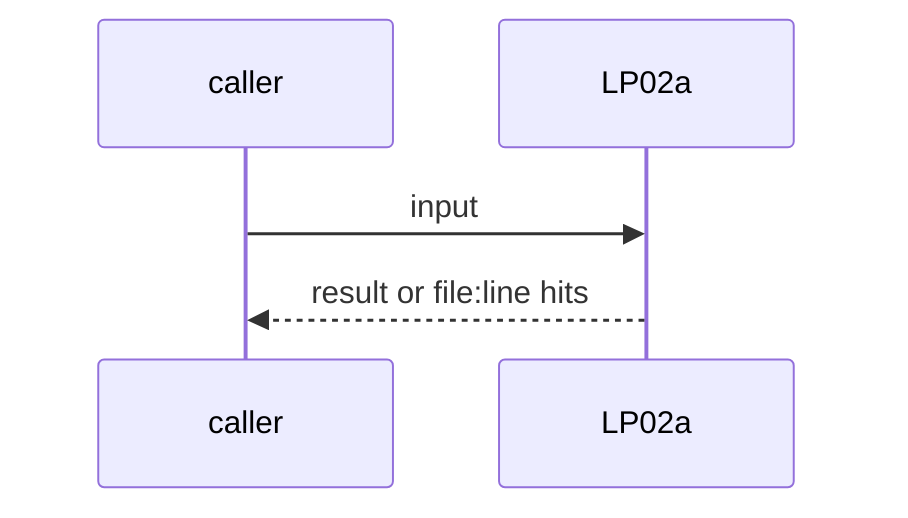
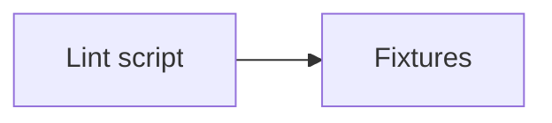

# LP02a: Lint: two workflows sharing a trigger and filter
- Status: todo
- Area: loops
- Wave: W3
- Block: 3
- Lane: Builder
- Depends on: LP02, POL25
- proof: lint red on a fixture with two workflows on the same trigger and filter; green on distinct ones
- door: two-way
- triage: build
- feedback: the lint on its fixtures
- harness: none (script run by scripts/verify.sh)
- review-input: diff + this PBI + DoD (+ linked spec) + PR description, never builder session logs (PA6)
- kind: script
- Source: D28 https://docs.warp.dev/factories/automations/
## Goal
A lint fails when two workflows share the same trigger and filter, because each match starts its own run.
## Context
Warp automations: "One event can match more than one automation, and each match starts its own run"; fix by narrowing overlapping triggers. Today POL25 keeps every agentic workflow on workflow_dispatch, so this matters once Sven says yes to an event. Not built in PR #4: docs only, nothing enabled (PA9).
## Steps
1. Lint script.
2. Fixtures.
## Definition of Done
- [ ] Red on duplicates
- [ ] Green on distinct triggers
## Technical design
- Components and files: a check under `policies/checks/`
- Module boundary: trigger + filter tuple
- Interfaces: frontmatter on:
- Sequence:

- Failure modes: Only exact duplicates are caught at first
- Security: No tokens
- Observability: verify.sh
- Cost: 0 AIC
- Rollback: Remove the lint
- Proof: same as proof: above
- Door: two-way (revert is one commit)
## Evidence
(todo)
## Flow

## Named asks for Sven
none
## Cost
0 AIC
## Sources
- [Warp automations doc](https://docs.warp.dev/factories/automations/)
- Strategy id list v3.12 (aw-final-ids.md), url-learnings.md D28
