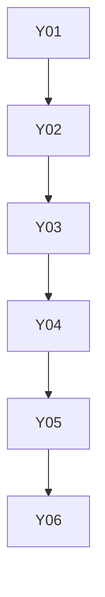

# memory: overview

**Purpose:** gh-aw memory features (cache, ledger, search integrations).

## PBIs

- [Y01: Y01-cache-memory](Y01-cache-memory.md)
- [Y02: Y02-repo-memory-ledger-compaction-replay](Y02-repo-memory-ledger-compaction-replay.md) (Block 4, M05 last-run marker, blocker for M05 step 2)
- [Y03: Y03-drive-memory](Y03-drive-memory.md)
- [Y04: Y04-qmd-doc-search](Y04-qmd-doc-search.md)
- [Y05: Y05-serena](Y05-serena.md)
- [Y06: Y06-web-search](Y06-web-search.md)

## Dependency sketch

