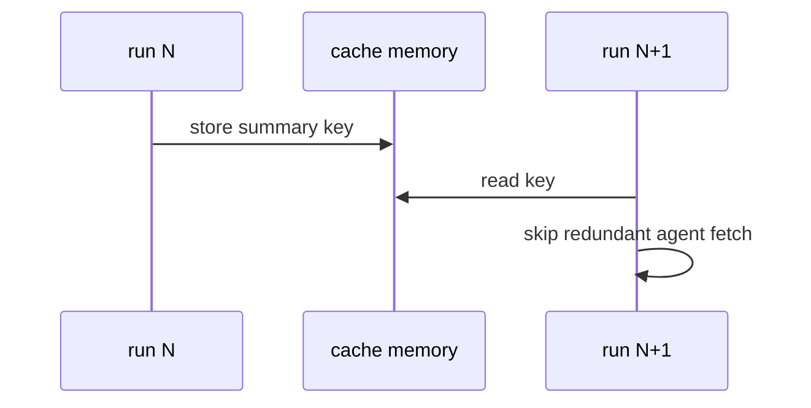

# Y01: Cache memory
- Status: todo
- Area: memory
- Wave: PR 0
- Block: 3
- Lane: Cursor CLI
- Depends on: C03
- proof: make verify
- door: two-way
## Goal
Document cache-memory for short-lived cross-run context without committing secrets to the repo.
## Context
Cache memory complements deterministic steps. Used lightly to avoid repeat fetches. MemoryOps pattern applies to metrics and status workflows later.
## Steps
1. Document cache-memory TTL and size limits from gh-aw reference.
2. Define what may be cached (public metadata) vs forbidden (tokens).
3. No secrets in files (workflow and docs; gitleaks in CI).
## Definition of Done
- [ ] Authoring guidance for when to use cache vs repo-memory (Y02).
- [ ] F12 metrics path notes cache-memory if adopted.
## Evidence
(commands, logs, verify log on SHA, run links)
## Flow

## Named asks for Sven
(none)
## Cost
n/a
## Sources
- https://github.github.com/gh-aw/reference/cache-memory/
- https://github.github.com/gh-aw/patterns/memory-ops/
