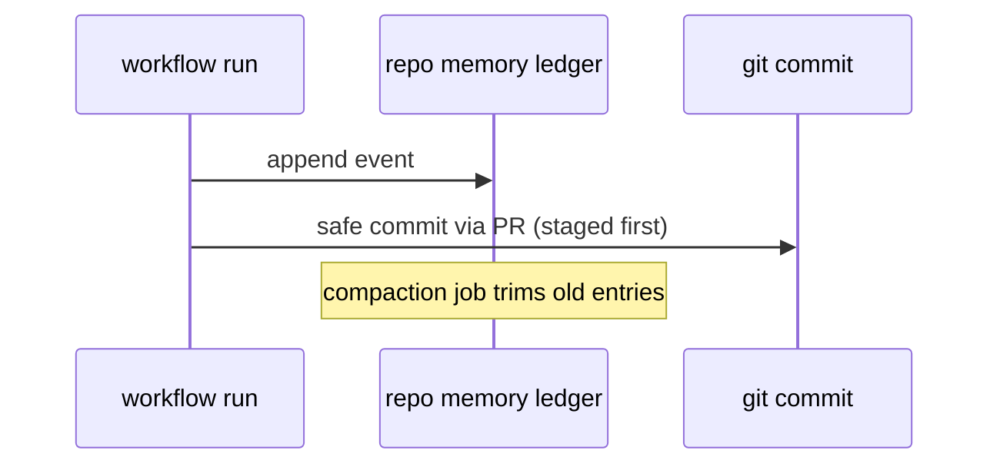

# Y02: Repo-memory ledger + compaction/replay
- Status: todo
- Area: memory
- Wave: PR 0
- Block: 4
- Lane: Cursor CLI
- Depends on: Y01, C02
- proof: ./scripts/verify.sh
- door: two-way
## Goal
Document git-backed repo-memory ledger, compaction, and replay for longitudinal workflow state.
## Context
Block 4 (moved from B5): holds the M05 last-run marker, so it is a blocker for [M05](../monitoring/M05-github-log-watcher.md) step 2.
Repo memory stores structured snapshots in-repo under gh-aw conventions. Compaction and replay are experimental but inform metrics and portfolio workflows.
## Steps
1. Summarize ledger specification and file layout.
2. Document compaction policy (retention windows).
3. Define replay for debugging without re-running agents.
4. Require CODEOWNERS on ledger paths.
## Definition of Done
- [ ] Ledger location and PR review rules documented.
- [ ] F12 metrics collector references Y02 when enabled.
## Evidence
(commands, logs, verify log on SHA, run links)
## Flow

## Named asks for Sven
(none)
## Cost
n/a
## Sources
- https://github.github.com/gh-aw/reference/repo-memory/
- https://github.github.com/gh-aw/specs/repo-memory-ledger-specification/
- https://github.github.com/gh-aw/experimental/ledger-compaction/
- https://github.github.com/gh-aw/experimental/ledger-replay/
