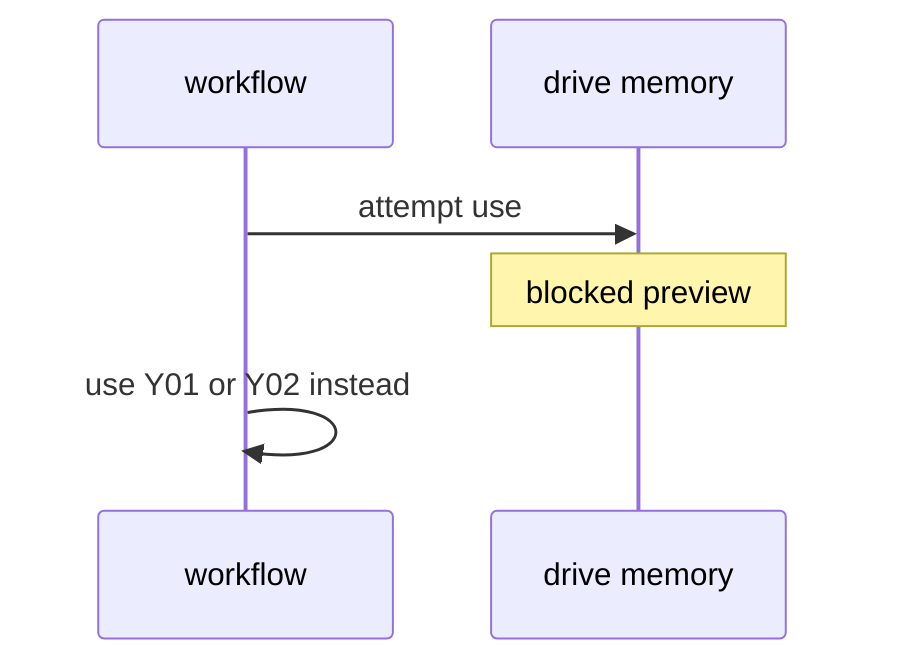

# Y03: Drive memory (private preview, blocked)
- Status: todo
- Area: memory
- Wave: PR 0
- Block: 6
- Lane: Cursor CLI
- Depends on: Y01
- proof: ./scripts/verify.sh
- door: two-way
## Goal
Record that drive memory private preview is blocked for this catalog until gh-aw stabilizes the API and personal account support is clear.
## Context
Experimental drive-memory is not available for production use. No workflow may depend on it in W1-W5.
## Steps
1. Summarize drive-memory experimental doc.
2. List unblock criteria (preview GA, auth model, cost).
3. Ensure no frontmatter references drive memory in v1.
## Definition of Done
- [ ] Explicit blocked status in memory folder README (Builder PR 0).
- [ ] No drive-memory imports in workflows/ until Y03 closes.
## Evidence
(commands, logs, verify log on SHA, run links)
## Flow

## Named asks for Sven
(none)
## Cost
n/a
## Sources
- https://github.github.com/gh-aw/experimental/drive-memory/
