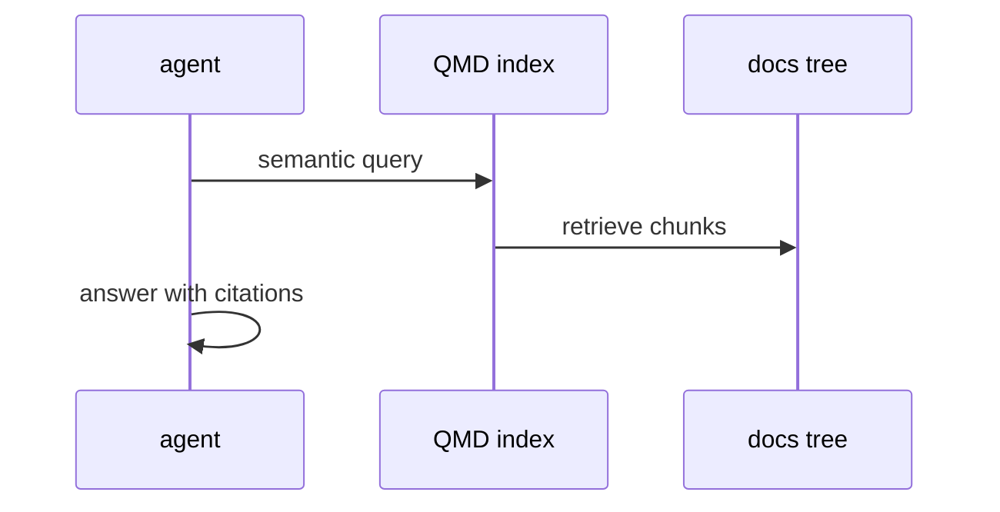

# Y04: QMD doc search
- Status: todo
- Area: memory
- Wave: PR 0
- Block: 6
- Lane: Cursor CLI
- Depends on: Y01, D05
- proof: ./scripts/verify.sh
- door: two-way
## Goal
Document QMD documentation search for agent context over Diataxis docs when cost and quality justify it.
## Context
QMD is experimental. Useful for doc-updater and large catalogs. Deferred to limit MCP/tool surface early.
## Steps
1. Summarize QMD experimental page and indexing requirements.
2. Define candidate workflows (F07) after B01 logging proves search quality.
3. Require tool allowlist entry and cap on search calls.
## Definition of Done
- [ ] Deferral documented with adoption criteria.
- [ ] Index scope limited to docs/ not consumer secrets.
## Evidence
(commands, logs, verify log on SHA, run links)
## Flow

## Named asks for Sven
(none)
## Cost
Tier M, 20-60 AIC per run when enabled (unverified)
## Sources
- https://github.github.com/gh-aw/experimental/qmd/
