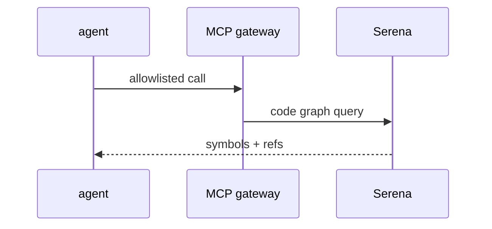

# Y05: Serena
- Status: todo
- Area: memory
- Wave: PR 0
- Block: 6
- Lane: Cursor CLI
- Depends on: S04, POL07
- proof: ./scripts/verify.sh
- door: two-way
## Goal
Document Serena code MCP integration path for semantic code navigation in advanced workflows.
## Context
Serena increases capability for refactors but expands MCP trust boundary. Later wave with strict allowlist.
## Steps
1. Summarize Serena reference and required MCP gateway config.
2. Map to POL07 tool allowlist process.
3. Identify candidate workflows (F12, F16) as optional.
## Definition of Done
- [ ] No Serena in W1-W3 default toolchains.
- [ ] Security review checklist drafted.
## Evidence
(commands, logs, verify log on SHA, run links)
## Flow

## Named asks for Sven
(none)
## Cost
Tier L, 60-150 AIC when enabled (unverified)
## Sources
- https://github.github.com/gh-aw/reference/serena/
