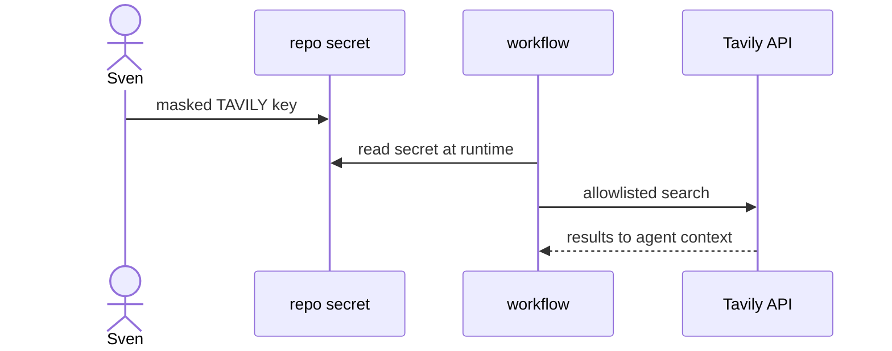

# Y06: Web search (Tavily)
- Status: todo
- Area: memory
- Wave: PR 0
- Block: 6
- Lane: Cursor CLI
- Depends on: S01
- proof: make verify
- door: one-way
- one-way gate: Sven's exact yes required (named ask in its block). Rollback: remove Tavily secret from repo settings
## Goal
Document web search tool integration with Tavily API key supplied only via masked GitHub secret, never files.
## Context
Web search expands network egress. Requires allowlist hosts and Sven-provided Tavily key. Default off for all catalog workflows.
## Steps
1. Summarize web-search reference and Tavily provider.
2. Document secret name convention (repo secret, masked input).
3. Require network allowlist entries for Tavily endpoints.
4. Cap search calls per run in workflow frontmatter.
## Definition of Done
- [ ] No Tavily key in repo or markdown.
- [ ] Workflows using web search document Tier L cost and Sven approval.
## Evidence
(commands, logs, verify log on SHA, run links)
## Flow

## Named asks for Sven
(Y06 (Tavily API key via masked field))
## Cost
Tier L, 60-150 AIC per run (unverified)
## Sources
- https://github.github.com/gh-aw/reference/web-search/
