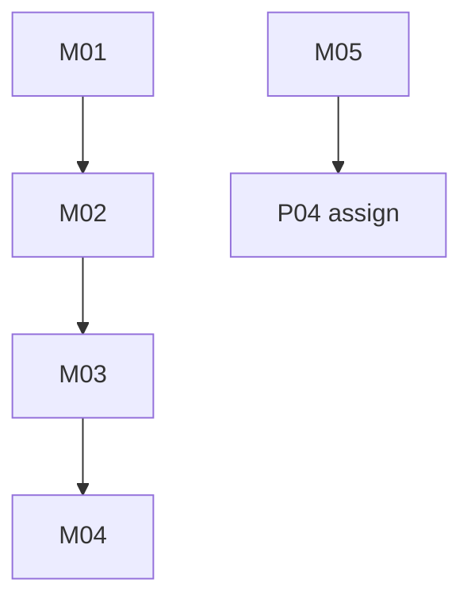

# monitoring: overview

**Purpose:** Azure exception watcher, GitHub cross-repo log watcher, and read-only MCP (dispatch first).

## PBIs

- [M01: M01-exception-watcher-dispatch](M01-exception-watcher-dispatch.md)
- [M02: M02-azure-oidc-reader](M02-azure-oidc-reader.md)
- [M03: M03-hourly-cron-watcher](M03-hourly-cron-watcher.md)
- [M04: M04-azure-mcp-read-only](M04-azure-mcp-read-only.md)
- [M05: M05-github-log-watcher](M05-github-log-watcher.md)

## Dependency sketch

