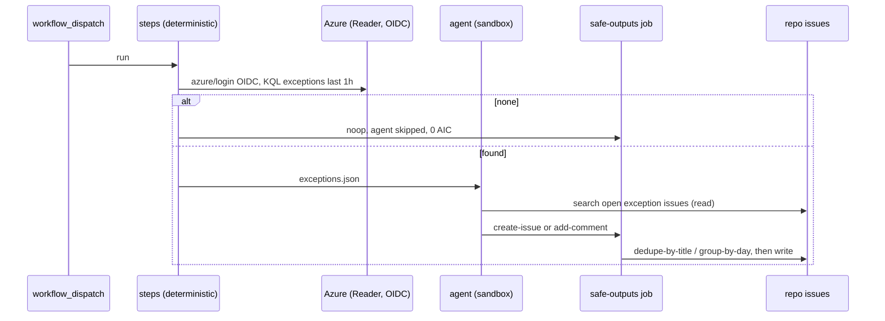

# M01: Exception watcher (dispatch-only, deterministic pre-step)
- Status: todo
- Area: monitoring
- Wave: W4
- Block: 4
- Lane: Builder
- Depends on: C03, C04, M02, S00
- proof: gh aw compile --dir workflows --strict; gh aw audit <run-id> (M01 trial run)
- door: one-way
- one-way gate: Sven's exact yes required (named ask in its block). Rollback: disable exception watcher workflow
## Goal
Detect Azure or Actions exceptions with deterministic OIDC + KQL (or log scrape), then optionally file deduped issues. Dispatch-only until M03 hourly is approved.
## Context

**How ours beats the example (Bar H):** shared defaults and pinned imports, low AIC caps, `workflow_dispatch` and staged/report-only before writes, dedupe and min-integrity, trial repo plus first-3-run audit, versus upstream gallery samples that often use higher defaults.
Implements MonitorOps + DeterministicOps. Agent runs only when exceptions.json is non-empty. Hourly cron is M03 (blocked until Sven yes + cost). Repo to resource map is Q5; issue target Q6.
**Trigger:** `workflow_dispatch` only (M03 adds hourly)

**Safe outputs:** create-issue or add-comment; dedupe-by-title, group-by-day, close-older-issues

## Steps
1. `workflow_dispatch` with inputs: target repo, workspace id (masked).
2. `steps:` azure/login OIDC (M02), run KQL for last window, write `/tmp/gh-aw/agent/exceptions.json` or noop.
3. If noop, agent skipped (0 AIC).
4. Else agent searches open `[exception]` issues, then create-issue or add-comment with dedupe keys.
5. No `on: schedule` in M01.
## Definition of Done
- [ ] Fetches own context with tools and imports (Bar H, gist A7); prompt never pastes repo content

- [ ] Mermaid flow (c) matches implemented steps
- [ ] Measured quiet-run cost is 0 AIC
- [ ] `imports:` shared/defaults.md (engine copilot, caps, admission, concurrency)
- [ ] Pinned gh-aw compiler version and every remote import uses tag or SHA (no @main)
- [ ] `max-ai-credits: 50`, `max-daily-ai-credits: 200`, `max-turns: 15`, `timeout-minutes: 10` (tune after measure)
- [ ] Deterministic `steps:` pre-check; `noop` when nothing to do (0 AIC path)
- [ ] `workflow_dispatch` plus staged/report-only rollout before production writes
- [ ] Dedupe: `deduplicate-by-title`, `group-by-day`, `close-older-issues`, `expires`
- [ ] `min-integrity: approved`, threat detection on, minimal `network` allowlist
- [ ] Tool, bash, and MCP allowlists; `on.roles` and skip-bots configured
- [ ] Issue/PR format matches `shared/reporting.md`
- [ ] Trial run on X01 test repo; `gh aw audit` on first 3 runs; measured AIC recorded in Evidence
- [ ] `make verify` pass on workflow SHA while Actions billing blocked (Q0)
## Evidence
(commands, `make verify` log on SHA, `gh aw` run links, audit output)
## Flow

## Named asks for Sven
Q5 (App Insights vs Log Analytics + repo map), Q6 (issue target)
## Cost
Tier S when quiet (0 AIC); Tier M ~45 AIC when exceptions found (unverified)
## Sources
- https://github.github.com/gh-aw/patterns/monitor-ops/
- https://github.github.com/gh-aw/patterns/deterministic-ops/
- https://github.github.com/gh-aw/reference/safe-outputs/
- Research packet flow (c): hourly exception watcher (Strategy gh-aw-org-packet)
