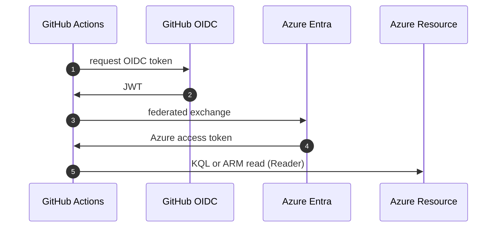

# M02: Azure OIDC Reader role and login step
- Status: todo
- Area: monitoring
- Wave: W4
- Block: 4
- Lane: Builder
- Depends on: C04, S00
- proof: gh aw compile --dir workflows --strict; gh aw audit <run-id> (M02 trial run)
- door: one-way
- one-way gate: Sven's exact yes required (named ask in its block). Rollback: remove federated credential and app registration
## Goal
Provide reusable deterministic Azure login (OIDC) with Reader role for KQL and health queries used by M01 and M04.
## Context

**How ours beats the example (Bar H):** shared defaults and pinned imports, low AIC caps, `workflow_dispatch` and staged/report-only before writes, dedupe and min-integrity, trial repo plus first-3-run audit, versus upstream gallery samples that often use higher defaults.
Named ask for Sven: Entra app registration, federated credential for GitHub, Reader on subscription or workspace. No secrets in repo; use GitHub secrets and `id-token: write`.
**Trigger:** n/a (library step)

**Safe outputs:** n/a

## Steps
1. Add `shared/azure-auth.md` (and link from `shared/mcp/` if needed) with OIDC login snippet for `steps:`.
2. Document federated credential subject for `svennijhuis/agentic-workflows`.
3. Validate login in dispatch workflow (noop query).
4. Block agent Azure MCP until M04.
## Definition of Done

- [ ] Reader-only role documented
- [ ] Login step works in dispatch test without agent
## Evidence
(commands, `scripts/verify.sh` log on SHA, `gh aw` run links, audit output)
## Flow

## Named asks for Sven
M02 Azure OIDC Reader (Entra app, federated cred, subscription/workspace ids via masked fields)
## Cost
n/a (deterministic steps only)
## Sources
- https://docs.github.com/actions/security-for-github-actions/security-hardening-your-deployments/configuring-openid-connect-in-azure
- https://github.github.com/gh-aw/guides/mcps/
