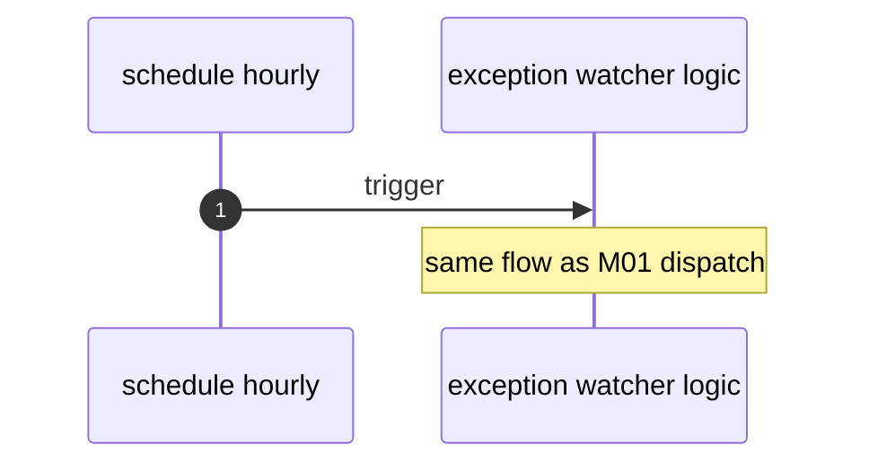

# M03: Hourly cron exception watcher
- Status: todo
- Area: monitoring
- Wave: W4
- Block: 4
- Lane: Builder
- Depends on: M01, M02, B02
- proof: gh aw compile --dir workflows --strict; gh aw audit <run-id> (M03 trial run)
- door: one-way
- one-way gate: Sven's exact yes required (named ask in its block). Rollback: disable hourly cron workflow
## Goal
Add fuzzy hourly schedule to the exception watcher after cost proof and explicit Sven approval.
## Context

**How ours beats the example (Bar H):** shared defaults and pinned imports, low AIC caps, `workflow_dispatch` and staged/report-only before writes, dedupe and min-integrity, trial repo plus first-3-run audit, versus upstream gallery samples that often use higher defaults.
Blocked until M01 dispatch runs are measured (target: quiet runs 0 AIC) and Sven says yes. Uses gh-aw fuzzy hourly schedule syntax.
**Trigger:** `on: schedule: hourly` only after approval

**Safe outputs:** same as M01

## Steps
1. Copy M01 workflow to scheduled variant or add `on: schedule` with cooldown.
2. Run 3 measured hours in test window; record AIC in B02.
3. Enable only after written yes from Sven.
## Definition of Done
- [ ] Fetches own context with tools and imports (Bar H, gist A7); prompt never pastes repo content

- [ ] Schedule absent until approval recorded in Evidence
- [ ] Daily AIC cap enforced
- [ ] `imports:` shared/defaults.md (engine copilot, caps, admission, concurrency)
- [ ] Pinned gh-aw compiler version and every remote import uses tag or SHA (no @main)
- [ ] `max-ai-credits: 50`, `max-daily-ai-credits: 200`, `max-turns: 15`, `timeout-minutes: 10` (tune after measure)
- [ ] Deterministic `steps:` pre-check; `noop` when nothing to do (0 AIC path)
- [ ] `workflow_dispatch` plus staged/report-only rollout before production writes
- [ ] Dedupe: `deduplicate-by-title`, `group-by-day`, `close-older-issues`, `expires`
- [ ] `min-integrity: approved`, threat detection on, minimal `network` allowlist
- [ ] Tool, bash, and MCP allowlists; `on.roles` and skip-bots configured
- [ ] Issue/PR format matches `shared/reporting.md`
- [ ] Trial run on X01 test repo; `gh aw audit` on first 3 runs; measured AIC recorded in Evidence
- [ ] `scripts/verify.sh` pass on workflow SHA while Actions billing blocked (Q0)
## Evidence
(commands, `scripts/verify.sh` log on SHA, `gh aw` run links, audit output)
## Flow

## Named asks for Sven
Sven yes for hourly cron + Q4 budget headroom
## Cost
Tier S quiet / Tier M active (unverified); multiply by 24 for day estimate
## Sources
- https://github.github.com/gh-aw/reference/schedule-syntax/
- https://github.github.com/gh-aw/reference/cost-management/
