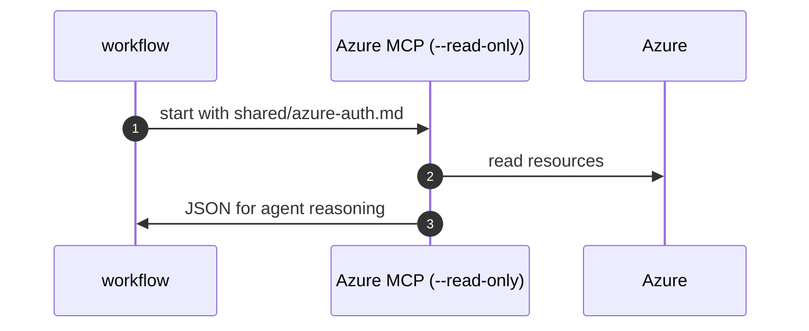

# M04: Azure MCP read-only via shared azure-auth
- Status: todo
- Area: monitoring
- Wave: W4
- Block: 4
- Lane: Builder
- Depends on: M02, S04
- proof: gh aw compile --dir workflows --strict; gh aw audit <run-id> (M04 trial run)
- door: one-way
- one-way gate: Sven's exact yes required (named ask in its block). Rollback: disable Azure MCP workflow
## Goal
Optional agent path to query Azure via `@azure/mcp` in `--read-only` mode, wired through `shared/azure-auth.md` import schema.
## Context

**How ours beats the example (Bar H):** shared defaults and pinned imports, low AIC caps, `workflow_dispatch` and staged/report-only before writes, dedupe and min-integrity, trial repo plus first-3-run audit, versus upstream gallery samples that often use higher defaults.
Gap: OIDC inside agent MCP is limited; prefer M01 deterministic KQL. M04 is exploratory read-only MCP after M02 login patterns exist.
**Trigger:** `workflow_dispatch` trial

**Safe outputs:** add-comment with findings; no Azure writes

## Steps
1. Finish `shared/azure-auth.md` with subscription/workspace params.
2. Allowlist `@azure/mcp` in tool policy with `--read-only`.
3. Dispatch trial workflow; compare AIC vs deterministic M01.
4. Default production path remains M01 steps.
## Definition of Done
- [ ] Fetches own context with tools and imports (Bar H, gist A7); prompt never pastes repo content

- [ ] MCP gateway allowlist matches workflow frontmatter
- [ ] No write commands in MCP argv
- [ ] `imports:` shared/defaults.md (engine copilot, caps, admission, concurrency)
- [ ] Pinned gh-aw compiler version and every remote import uses tag or SHA (no @main)
- [ ] `max-ai-credits: 50`, `max-daily-ai-credits: 200`, `max-turns: 15`, `timeout-minutes: 10` (tune after measure)
- [ ] Deterministic `steps:` pre-check; `noop` when nothing to do (0 AIC path)
- [ ] `workflow_dispatch` plus staged/report-only rollout before production writes
- [ ] Dedupe: `deduplicate-by-title`, `group-by-day`, `close-older-issues`, `expires`
- [ ] `min-integrity: approved`, threat detection on, minimal `network` allowlist
- [ ] Tool, bash, and MCP allowlists; `on.roles` and skip-bots configured
- [ ] Issue/PR format matches `shared/reporting.md`
- [ ] Trial run on X01 test repo; `gh aw audit` on first 3 runs; measured AIC recorded in Evidence
- [ ] `make verify` pass on workflow SHA while Actions billing blocked (Q0)
## Evidence
(commands, `make verify` log on SHA, `gh aw` run links, audit output)
## Flow

## Named asks for Sven
Q5 (workspace map), B04 OTLP target if tracing MCP
## Cost
Tier M ~50 AIC per interactive query (unverified)
## Sources
- https://github.github.com/gh-aw/guides/mcps/
- https://github.com/Azure/azure-mcp/blob/main/docs/azmcp-commands.md
