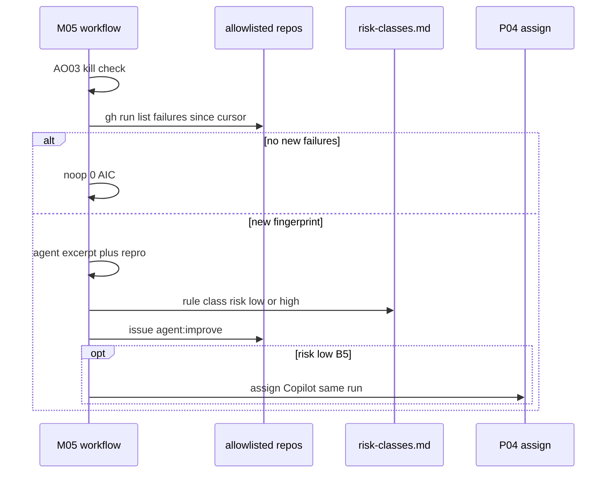
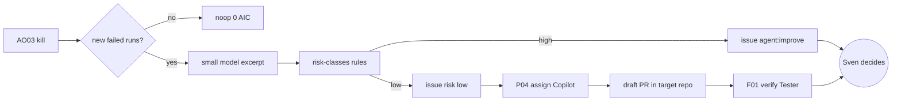

# M05: GitHub log watcher (cross-repo self-fix)
- Status: todo
- Area: monitoring
- Wave: W3
- Block: 3, 4, 5
- Lane: Builder
- Depends on: B01, Y02, AO03, POL12, C03, O05, P04
- Relates: P01 (not a blocker)
- Step 2 blockers: O05 (cross-repo outputs), POL12, AO03, Y02 (repo memory holding the last-run marker); all land before M05 step 2 in B4
- proof: gh aw compile --dir workflows --strict workflows/m05-github-log-watcher.md && ./scripts/verify.sh
- door: one-way
- one-way gate: each rollout step needs 3 audited runs + measured AIC + Sven's exact yes. Rollback: set the AO03 kill var for M05 and remove repos from aw.yml m05.repos
## Goal
Fold **F76 log insights** into one central workflow in agentic-workflows that reads failed Actions runs across an allowlisted set of personal repos, opens deduped `agent:improve` issues with risk class, and for `risk:low` hands off to [P04](../multi-repo/P04-research-plan-assign-copilot.md) in the same run without `agent-ok` (rule-gated bot path per [LP02](../loops/LP02-event-map.md)).
## Context
[LP00 v2](../loops/LP00-improvement-loop.md) cross-repo self-fix. Step 2 blockers: [O05](../safe-outputs/O05-cross-repo.md) cross-repo outputs, [POL12](../policies/POL12-explicit-allowed-repos-target-repo.md), [AO03](../agent-ops/AO03-kill-switch.md) and [Y02](../memory/Y02-repo-memory-ledger-compaction-replay.md) (repo memory holding the last-run marker) all land before step 2 in B4. [P01](../multi-repo/P01-central-repo-ops-hub.md) only relates (B5), it does not block. Rollout: Block 3 report-only on one repo; Block 4 writes issues on all `aw.yml` `m05.repos` entries; Block 5 enables auto-fix for `risk:low`. [POL12](../policies/POL12-explicit-allowed-repos-target-repo.md) fails if any owner is not svennijhuis. [AO03](../agent-ops/AO03-kill-switch.md) pre-step noops the workflow. Log text is untrusted input (OWASP LLM01) and reaches the agent as data only. Merge rule: Sven merges fix PRs; an agent never merges.
## Steps
1. Add `workflows/m05-github-log-watcher.md`; import `shared/defaults.md`, `shared/risk-classes.md`, and [C03](../core/C03-shared-defaults.md) alias `small` with low `max-turns`.
2. Pre-step (0 AIC): `gh run list --status failure` per allowlisted repo since last cursor in [Y02](../memory/Y02-repo-memory-ledger-compaction-replay.md); noop when nothing new.
3. Fingerprint repo + workflow + step + error hash; known fingerprint only increments count in issue body.
4. Agent writes one deduped issue per new fingerprint in the target repo: log excerpt, repro command, first seen, count, labels `agent:improve` and `risk:low` or `risk:high`.
5. Apply rules from `shared/risk-classes.md` (low: lint, markdown or docs, flaky test that passed on rerun, dependency patch bump, CI config typo; high: auth, payment, secret, infra or bicep or terraform, Azure, `.github/workflows/`, `workflows/*.md`, or no rule match). Model may raise low to high, never high to low.
6. `risk:low`: same-run handoff to P04 (assign Copilot cloud agent); no `agent-ok` label. `risk:high`: issue only; Sven decides.
7. Caps: 5 issues per day across all repos; 1 open auto-fix PR per repo; same fingerprint twice opens a POL PBI (A5).
8. Rollout steps: B3 report-only one repo, B4 all allowlisted repos write issues, B5 auto-fix risk low (each step: 3 audited runs + measured AIC + Sven yes).
## Definition of Done
- [ ] Fetches own context with tools and imports (Bar H); prompt never pastes full logs without excerpt limits
- [ ] `imports:` shared/defaults.md (engine copilot, caps, admission, concurrency)
- [ ] Pinned gh-aw compiler version and every remote import uses tag or SHA (no @main)
- [ ] `max-ai-credits: 50`, `max-daily-ai-credits: 200`, `max-turns` low, `timeout-minutes: 10` (tune after measure)
- [ ] Deterministic pre-step; noop when no new failures (0 AIC)
- [ ] `workflow_dispatch` and event path per rollout step; staged/report-only until promoted
- [ ] Dedupe by fingerprint; `shared/reporting.md` issue format
- [ ] `min-integrity: approved`, threat detection on, minimal network allowlist
- [ ] Tool, bash, and MCP allowlists; `on.roles` and skip-bots configured
- [ ] Trial on X01 plus first repo in allowlist; `gh aw audit` on first 3 runs per rollout step; AIC in Evidence
- [ ] `scripts/verify.sh` pass on workflow SHA
- [ ] X07 benchmark score at or above baseline (5+ cases)
- [ ] POL12 check on `m05.repos`; only svennijhuis owners
- [ ] AO03 kill switch wired in pre-step
## Technical design
- Components and files: `workflows/m05-github-log-watcher.md`, `aw.yml` key `m05.repos`, `shared/risk-classes.md`, repo-memory cursor via Y02, cross-repo issue writes via [O05](../safe-outputs/O05-cross-repo.md)
- Interfaces: secret `M05_READ_TOKEN` (Actions read, Contents read, Issues write on allowlisted repos only); deterministic `gh` steps; agent step with C03 `small` alias; safe-output `create-issue` in target repo; inline P04 assign job for risk low
- Sequence:

- Failure modes: token scope miss skips repo with comment; Copilot not enabled skips assign per P04; daily cap drops new issues until next day
- Security: M05_READ_TOKEN least scope; log lines untrusted (LLM01); no contents or PR write on our tokens; POL12 owner gate
- Observability: B01 run audit; fingerprint counters in issue body; spend in B02
- Cost: small model and low turns; measured per rollout step in Evidence
- Rollback: AO03 kill var for M05; clear `m05.repos` entries in aw.yml
- Proof: staged run on one allowlisted repo with red failure fixture
- Door: one-way (cross-repo tokens and issue writes; each rollout step needs Sven yes)
## Evidence
(verify log on SHA, three audited runs per rollout step, AIC table, sample `agent:improve` issue link)
## Flow

## Named asks for Sven
M05_READ_TOKEN: fine-grained PAT with Actions read, Contents read, Issues write on allowlisted repos only; Sven sets it himself in agentic-workflows (one-way). Copilot cloud agent enabled per target repo (decide on first Block 5 proof run; one-way per repo).
## Cost
Tier S to M per repo batch (unverified); cap 5 issues per day all repos
## Sources
- Plan v3.7 F76 log chain; Plan v3.9 M05 cross-repo; [LP00-improvement-loop.md](../loops/LP00-improvement-loop.md), [LP02-event-map.md](../loops/LP02-event-map.md)
- Folds F76 log insights (no separate F76 file)
- Related: [AO03-kill-switch.md](../agent-ops/AO03-kill-switch.md), [POL12-explicit-allowed-repos-target-repo.md](../policies/POL12-explicit-allowed-repos-target-repo.md), [P04-research-plan-assign-copilot.md](../multi-repo/P04-research-plan-assign-copilot.md)
