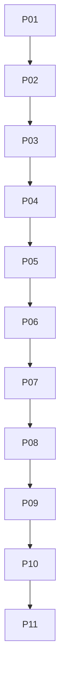

# multi-repo: overview

**Purpose:** Central hub, orchestrator, portfolio operations.

## PBIs

- [P01: P01-central-repo-ops-hub](P01-central-repo-ops-hub.md)
- [P02: P02-orchestrator-worker-dependabot-rollout](P02-orchestrator-worker-dependabot-rollout.md)
- [P03: P03-side-repo-slash-bridge](P03-side-repo-slash-bridge.md)
- [P04: P04-research-plan-assign-copilot](P04-research-plan-assign-copilot.md)
- [P05: P05-project-board-monitoring](P05-project-board-monitoring.md)
- [P06: P06-feature-sync](P06-feature-sync.md)
- [P07: P07-portfolio-health-stale-repos](P07-portfolio-health-stale-repos.md)
- [P08: P08-batch-ops](P08-batch-ops.md)
- [P09: P09-feature-grower](P09-feature-grower.md)
- [P10: P10-spec-ops](P10-spec-ops.md)
- [P11: P11-work-queue-ops](P11-work-queue-ops.md)

## Dependency sketch

