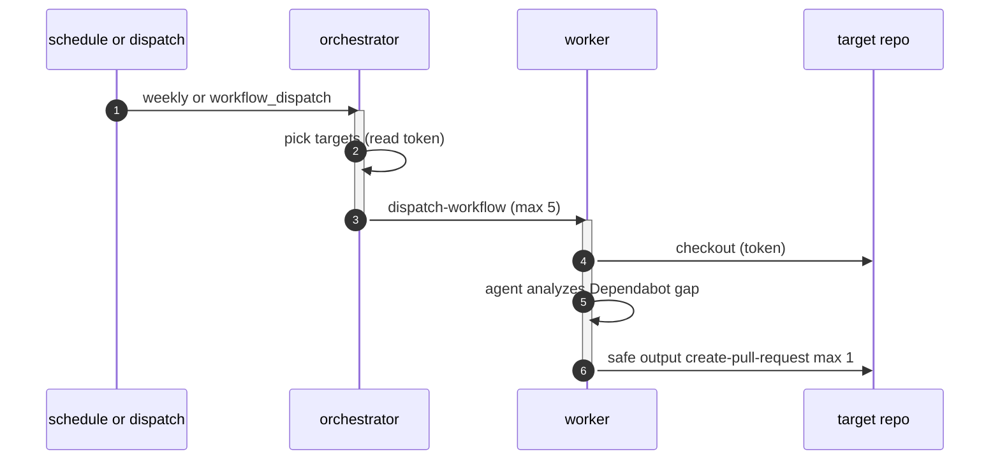

# P02: Orchestrator and worker (Dependabot rollout)
- Status: todo
- Area: multi-repo
- Wave: W5
- Block: 5
- Lane: Builder
- Depends on: P01, C04, R01, O05
- proof: gh aw compile --dir workflows --strict && ./scripts/verify.sh
- door: one-way
- one-way gate: Sven's exact yes required (named ask in its block). Rollback: disable workflow via workflow_dispatch off or remove schedule trigger
## Goal
Orchestrate bounded parallel work across repos using orchestrator/worker dispatch, with Dependabot config rollout as the first job.
## Context

**How ours beats the example (Bar H):** shared defaults and pinned imports, low AIC caps, `workflow_dispatch` and staged/report-only before writes, dedupe and min-integrity, trial repo plus first-3-run audit, versus upstream gallery samples that often use higher defaults.
Gallery dependabot-rollout is the reference. Cap concurrent workers (max 5). Workers checkout targets and may open one PR each when promoted from staged mode.
**Trigger:** `workflow_dispatch` then optional weekly schedule after yes

**Safe outputs:** create-pull-request on target-repo, max 1 per worker run

## Steps
1. Add `workflows/orchestrator-dependabot-rollout.md` with worker dispatch and concurrency caps.
2. Orchestrator picks targets from config (no wildcard repos).
3. Worker: report-only lists planned file changes; staged opens max 1 PR per target.
4. Record rollout ladder in workflow README snippet.
## Definition of Done

- [ ] Worker count and `target-repo` list are explicit in frontmatter/config
- [ ] `imports:` shared/defaults.md (engine copilot, caps, admission, concurrency)
- [ ] Pinned gh-aw compiler version and every remote import uses tag or SHA (no @main)
- [ ] `max-ai-credits: 50`, `max-daily-ai-credits: 200`, `max-turns: 15`, `timeout-minutes: 10` (tune after measure)
- [ ] Deterministic `steps:` pre-check; `noop` when nothing to do (0 AIC path)
- [ ] `workflow_dispatch` plus staged/report-only rollout before production writes
- [ ] Dedupe: `deduplicate-by-title`, `group-by-day`, `close-older-issues`, `expires`
- [ ] `min-integrity: approved`, threat detection on, minimal `network` allowlist
- [ ] Tool, bash, and MCP allowlists; `on.roles` and skip-bots configured
- [ ] Issue/PR format matches `shared/reporting.md`
- [ ] Trial run on X01 test repo; `gh aw audit` on first 3 runs; measured AIC recorded in Evidence
- [ ] `scripts/verify.sh` pass on workflow SHA while Actions billing blocked (Q0)
## Evidence
(commands, `scripts/verify.sh` log on SHA, `gh aw` run links, audit output)
## Flow

## Named asks for Sven
Q1, Q3
## Cost
Tier L, ~80 AIC per worker (unverified); orchestrator near 0 AIC if deterministic
## Sources
- https://github.github.com/gh-aw/gallery/multi-repo/dependabot-rollout/
- https://github.github.com/gh-aw/patterns/orchestrator-ops/
