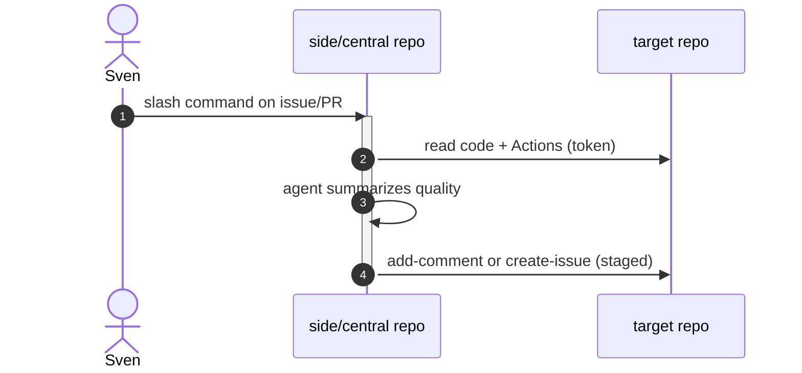

# P03: Side repo, slash bridge, and code quality monitoring
- Status: todo
- Area: multi-repo
- Wave: W5
- Block: 5
- Lane: Builder
- Depends on: C04, R03, P01
- proof: gh aw compile --dir workflows --strict && ./scripts/verify.sh
- door: one-way
- one-way gate: Sven's exact yes required (named ask in its block). Rollback: disable workflow via workflow_dispatch off or remove schedule trigger
## Goal
Operate automation from a side repo (or central) that targets main product repos via slash commands and scheduled code-quality checks.
## Context

**How ours beats the example (Bar H):** shared defaults and pinned imports, low AIC caps, `workflow_dispatch` and staged/report-only before writes, dedupe and min-integrity, trial repo plus first-3-run audit, versus upstream gallery samples that often use higher defaults.
Combines gallery triage-from-side-repo and code-quality-monitoring. ChatOps uses R03; cross-repo writes need PAT or App (Q3).
**Trigger:** issue_comment slash + `workflow_dispatch`

**Safe outputs:** add-comment, create-issue on target-repo; staged first

## Steps
1. Add slash-triggered workflow (e.g. `/quality-report`) with report-only default.
2. Add scheduled or dispatch quality scan targeting allowlisted repos.
3. Bridge: side repo issues link to target findings via fixed footer format.
4. Enforce `tools.github.allowed-repos` list.
## Definition of Done

- [ ] Slash command documented in consumer guide (D01)
- [ ] Code quality findings use shared reporting footer
- [ ] `imports:` shared/defaults.md (engine copilot, caps, admission, concurrency)
- [ ] Pinned gh-aw compiler version and every remote import uses tag or SHA (no @main)
- [ ] `max-ai-credits: 50`, `max-daily-ai-credits: 200`, `max-turns: 15`, `timeout-minutes: 10` (tune after measure)
- [ ] Deterministic `steps:` pre-check; `noop` when nothing to do (0 AIC path)
- [ ] `workflow_dispatch` plus staged/report-only rollout before production writes
- [ ] Dedupe: `deduplicate-by-title`, `group-by-day`, `close-older-issues`, `expires`
- [ ] `min-integrity: approved`, threat detection on, minimal `network` allowlist
- [ ] Tool, bash, and MCP allowlists; `on.roles` and skip-bots configured
- [ ] Issue/PR format matches `shared/reporting.md`
- [ ] Trial run on X01 test repo; `gh aw audit` on first 3 runs; measured AIC recorded in Evidence
- [ ] `scripts/verify.sh` pass on workflow SHA while Actions billing blocked (Q0)
## Evidence
(commands, `scripts/verify.sh` log on SHA, `gh aw` run links, audit output)
## Flow

## Named asks for Sven
Q1, Q3
## Cost
Tier M, ~40 AIC per target scan (unverified)
## Sources
- https://github.github.com/gh-aw/gallery/multi-repo/triage-from-side-repo/
- https://github.github.com/gh-aw/gallery/multi-repo/code-quality-monitoring/
- https://github.github.com/gh-aw/patterns/chat-ops/
