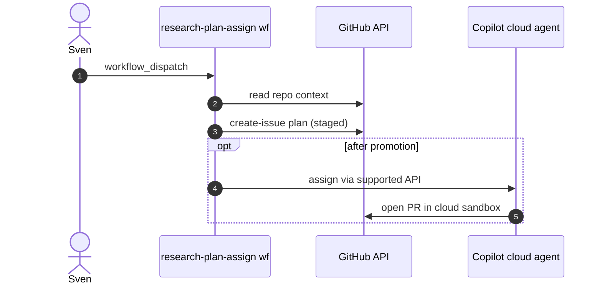

# P04: Research, plan, assign to Copilot cloud agent
- Status: todo
- Area: multi-repo
- Wave: W5
- Block: 5
- Lane: Builder
- Depends on: C04, T01, G01
- proof: gh aw compile --dir workflows --strict && ./scripts/verify.sh
- door: one-way
- one-way gate: Sven's exact yes required (named ask in its block). Rollback: disable workflow via workflow_dispatch off or remove schedule trigger
## Goal
Turn a research prompt into a plan issue and optional Copilot cloud agent assignment across allowed repos.
## Context

**How ours beats the example (Bar H):** shared defaults and pinned imports, low AIC caps, `workflow_dispatch` and staged/report-only before writes, dedupe and min-integrity, trial repo plus first-3-run audit, versus upstream gallery samples that often use higher defaults.
ResearchPlanAssignOps pattern. High write risk; stay report-only until Sven promotes. Teams path (T02) may parallel cloud agent handoff.
**Trigger:** `workflow_dispatch` only until promoted

**Safe outputs:** create-issue; optional assign Copilot after gate

## Steps
1. `workflow_dispatch` with inputs: repo, topic, depth.
2. Agent produces plan issue (no assign) in report-only.
3. After promotion: optional assign Copilot with explicit label cookie.
4. Cross-repo assign requires PAT scopes (Q3).
## Definition of Done

- [ ] No Copilot assign until staged gate passed
- [ ] Plan issue uses PBI-style checklist body
- [ ] `imports:` shared/defaults.md (engine copilot, caps, admission, concurrency)
- [ ] Pinned gh-aw compiler version and every remote import uses tag or SHA (no @main)
- [ ] `max-ai-credits: 50`, `max-daily-ai-credits: 200`, `max-turns: 15`, `timeout-minutes: 10` (tune after measure)
- [ ] Deterministic `steps:` pre-check; `noop` when nothing to do (0 AIC path)
- [ ] `workflow_dispatch` plus staged/report-only rollout before production writes
- [ ] Dedupe: `deduplicate-by-title`, `group-by-day`, `close-older-issues`, `expires`
- [ ] `min-integrity: approved`, threat detection on, minimal `network` allowlist
- [ ] Tool, bash, and MCP allowlists; `on.roles` and skip-bots configured
- [ ] Issue/PR format matches `shared/reporting.md`
- [ ] Trial run on X01 test repo; `gh aw audit` on first 3 runs; measured AIC recorded in Evidence
- [ ] `scripts/verify.sh` pass on workflow SHA while Actions billing blocked (Q0)
## Evidence
(commands, `scripts/verify.sh` log on SHA, `gh aw` run links, audit output)
## Flow

## Named asks for Sven
Q3, Q8 (if Teams handoff)
## Cost
Tier L, ~90 AIC per plan (unverified)
## Sources
- https://github.github.com/gh-aw/patterns/research-plan-assign-ops/
- https://docs.github.com/en/copilot/how-tos/copilot-integrations/integrate-cloud-agent-with-teams
