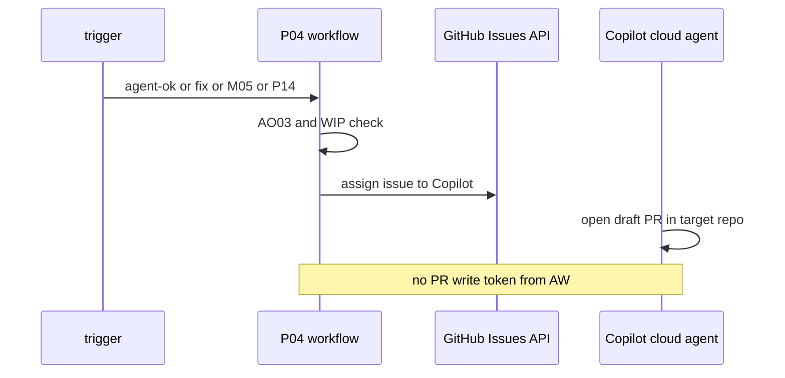
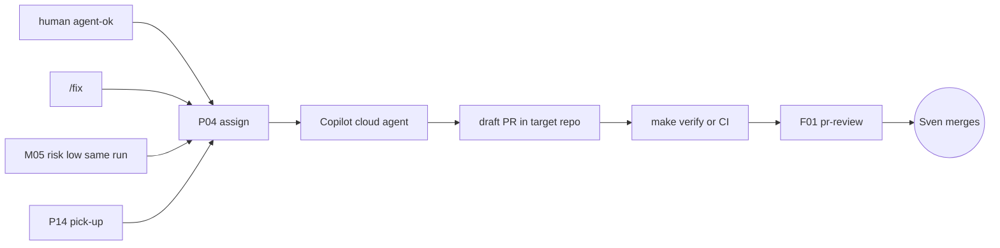

# P04: Issue to Copilot cloud agent (research, plan, assign)
- Status: todo
- Area: multi-repo
- Wave: W5
- Block: 5
- Lane: Builder
- Depends on: C04, M05, AO03, G01
- proof: gh aw compile --dir workflows --strict workflows/p04-assign-copilot.md && make verify; B5 proof assigns Copilot on X01 test repo with P04_ASSIGN_TOKEN scope only
- door: one-way
- one-way gate: Sven's exact yes required (Copilot enablement per repo and P04_ASSIGN_TOKEN). Rollback: set AO03 kill var for P04; remove workflow trigger
## Goal
Fold **F77 issue to PR** into assign-only handoff: P04 runs centrally in agentic-workflows and **only assigns** the issue to the Copilot cloud agent in the target repo. The Copilot cloud agent opens the draft PR inside that repo under its own identity. Our workflow never pushes code or opens a PR in another repo; no contents:write or pull-requests:write token of ours exists.
## Context
[LP00](../loops/LP00-improvement-loop.md) step 3 and [LP01](../loops/LP01-delivery-loop.md) pick-up via [P14](P14-board-pick-up.md). **Triggers:** human `agent-ok` label (label actor must be a human with write), `/fix`, [M05](../monitoring/M05-github-log-watcher.md) `risk:low` same-run handoff (no `agent-ok`), and P14 pick-up. Rejected: central write PAT across repos; per-repo P04 copies. After the draft PR: [F01](../agent-factory/F01-pr-review.md) review, `make verify` or that repo's CI, Tester, then Sven merges; an agent never merges. Caps: 1 open auto-fix PR per repo (WIP 1). If Copilot cloud agent is not enabled for a repo, P04 skips assign and comments on the issue (no fallback PR).
**How ours beats the example (Bar H):** shared defaults, pinned imports, caps, staged rollout, dedupe, trial repo plus first-3-run audit.
## Steps
1. Add `workflows/p04-assign-copilot.md`; deterministic pre-check (noop when issue already assigned or cap hit).
2. Wire triggers: `issues` labeled `agent-ok` (human actor), slash `/fix`, repository_dispatch or job output from M05 risk low, P14 dispatch payload.
3. Assign issue to Copilot cloud agent via GitHub API using `P04_ASSIGN_TOKEN` (Issues write + Metadata read, allowlisted repos only, separate from M05_READ_TOKEN).
4. Document post-assign chain: F01, verify or CI, Tester, human merge.
5. B5 proof run 1 on X01: assign works with this exact scope; if GitHub needs more than Issues write, proof names minimum extra scope for Sven to decide.
## Definition of Done
- [ ] Assign only; no cross-repo PR or push from our workflow
- [ ] Triggers: `agent-ok` (human), `/fix`, M05 risk low handoff, P14 pick-up
- [ ] `imports:` shared/defaults.md (engine copilot, caps, admission, concurrency)
- [ ] Pinned gh-aw compiler version and every remote import uses tag or SHA (no @main)
- [ ] `max-ai-credits: 50`, `max-daily-ai-credits: 200`, `max-turns: 15`, `timeout-minutes: 10` (tune after measure)
- [ ] Deterministic `steps:` pre-check; noop when nothing to do (0 AIC path)
- [ ] `workflow_dispatch` plus staged rollout before production assigns
- [ ] Dedupe and min-integrity; threat detection on; network and tool allowlists
- [ ] `on.roles` and skip-bots; bot labels never start assign except M05 rule-gated handoff
- [ ] Issue format matches `shared/reporting.md`
- [ ] Trial on X01; `gh aw audit` on first 3 runs; measured AIC in Evidence
- [ ] `make verify` pass on workflow SHA
- [ ] X07 benchmark score at or above baseline (5+ cases)
- [ ] WIP 1 open auto-fix PR per repo enforced
## Technical design
- Components and files: `workflows/p04-assign-copilot.md`, aw.yml allowlist aligned with workflow frontmatter, optional comment template when Copilot disabled
- Interfaces: secret `P04_ASSIGN_TOKEN`; safe-output comment and assign; inputs `target-repo`, `issue-number`; concurrency per issue; AO03 pre-step
- Sequence:

- Failure modes: missing Copilot enablement comments and exits; cap exceeded noops; kill switch noop
- Security: P04_ASSIGN_TOKEN Issues write only on allowlist; separate from M05 read token; workflow frontmatter owner check
- Observability: assign events in B01; link issue to PR in target repo
- Cost: mostly deterministic assign steps; low AIC unless agent summarizes issue
- Rollback: AO03 kill var for P04; disable triggers
- Proof: B5 assign proof on X01 with recorded API response
- Door: one-way (assign and cross-repo tokens; Copilot enablement per repo)
## Evidence
(commands, verify log on SHA, gh aw run links, assign proof screenshot or API log, three-run AIC table)
## Flow

## Named asks for Sven
P04_ASSIGN_TOKEN: fine-grained PAT, allowlisted repos only, Issues write + Metadata read, set by Sven himself in agentic-workflows (one-way). Copilot cloud agent enabled per target repo (Sven, one-way per repo).
## Cost
Tier L, mostly 0 AIC assign steps; tune after measure
## Sources
- Plan v3.9b P04 assigns only; loops.md Who opens the PR
- Folds F77 issue to PR (no separate F77 file)
- https://github.github.com/gh-aw/patterns/research-plan-assign-ops/
