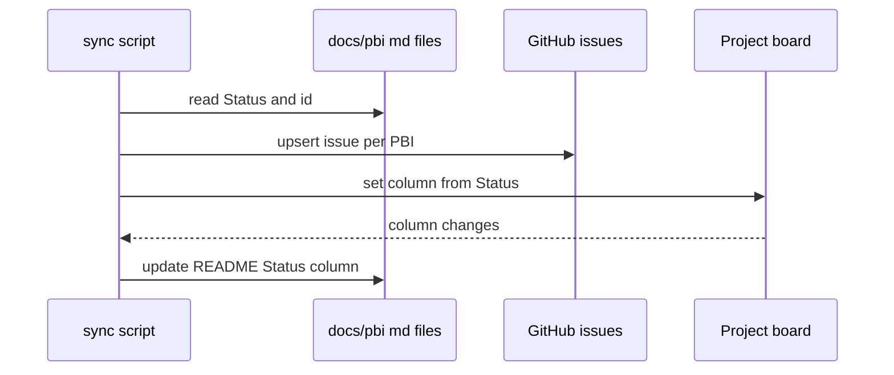
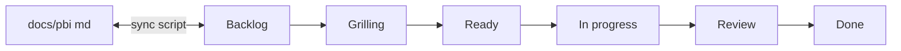

# P05: Project board expanded (sync)
- Status: todo
- Area: multi-repo
- Wave: W5
- Block: 3
- Lane: Builder
- Depends on: C04
- proof: ./scripts/sync-pbi-board.sh --dry-run && test -f docs/pbi/README.md
- door: two-way
## Goal
User-owned GitHub Project on the personal account with columns Backlog, Grilling, Ready, In progress, Review, and Done. A sync script maps `docs/pbi/*.md` to issues (one per PBI, id in title) and flows Status back into the README index Status column ([LP01](../loops/LP01-delivery-loop.md) board step).
## Context
Delivery loop board per Plan v3.8. Two-way door: script only, 0 AIC, no agent tokens for sync. The script authenticates with `BOARD_TOKEN` (shared with the P14 poll pre-step); setting that secret is a one-way step Sven does himself. Workflow health monitoring from the earlier experimental pattern stays a later step only if it does not conflict with P12, P13, and P14 column semantics.
## Steps
1. Document Project v2 field mapping (Status column matches board columns).
2. Add `scripts/sync-pbi-board.sh`: read PBI frontmatter Status; create or update issues; write Status back to README index.
3. Idempotent sync keyed by PBI id in issue title.
4. Optional later: link exception items from M01 without overwriting delivery columns.
## Definition of Done
- [ ] Project columns documented: Backlog, Grilling, Ready, In progress, Review, Done
- [ ] Sync script dry-run documented; no secrets in repo files
- [ ] One issue per PBI id; README Status column updates from board
- [ ] door two-way (script sync, 0 AIC)
- [ ] Mermaid flow present
- [ ] Sync script reads only `BOARD_TOKEN` (never an agent job); first run records whether a fine-grained token reaches the user-owned board, or names the classic scope for Sven
## Technical design
- Components and files: `scripts/sync-pbi-board.sh`, `docs/pbi/README.md` Status column, user Project on svennijhuis account, optional `gh-project` env var for project id
- Interfaces: CLI flags `--dry-run`, `--push`; auth via `BOARD_TOKEN` env (masked secret); reads `docs/pbi/**/*.md` frontmatter; GitHub Issues and Projects v2 GraphQL for item status
- Sequence:

- Failure modes: missing project id fails dry-run with message; title collision warns and skips
- Security: `BOARD_TOKEN` only (Projects read and write on the user board only), from a masked secret or the developer machine; deterministic script, no agent job sees it; no token in git
- Observability: script logs counts of created, updated, unchanged
- Cost: 0 AIC (deterministic script)
- Rollback: revert README and issue title mapping doc; board manual cleanup
- Proof: `./scripts/sync-pbi-board.sh --dry-run` output in Evidence; first run notes fine-grained vs classic scope result for `BOARD_TOKEN`
- Door: two-way (sync script, no workflow tokens required)
## Evidence
(dry-run log, sample issue titles with PBI ids, README Status snippet)
## Flow

## Named asks for Sven
`BOARD_TOKEN`: one token for the user Project board, Projects read and write on the svennijhuis user board only. Used only by deterministic jobs (the P05 sync script and the P14 poll pre-step), never by an agent job. Sven sets it himself (one-way door). Proof: the first P05 run checks whether a fine-grained token can reach a user-owned board; if not, that run names the classic scope and Sven decides. GitHub Project id via masked env when script runs in Actions (optional); personal account project only
## Cost
0 AIC for sync script
## Sources
- Plan v3.8 P05 board expanded; [LP01-delivery-loop.md](../loops/LP01-delivery-loop.md)
- https://github.github.com/gh-aw/experimental/monitoring-with-projects/ (monitoring deferred)
