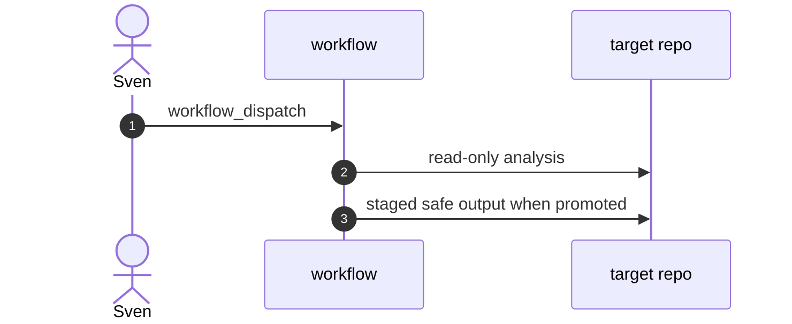

# P11: WorkQueueOps git-backed queue
- Status: todo
- Area: multi-repo
- Wave: W6
- Block: 6
- Lane: Builder
- Depends on: P01, C02, G01
- proof: gh aw compile --dir workflows --strict && ./scripts/verify.sh
- door: one-way
- one-way gate: Sven's exact yes required (named ask in its block). Rollback: disable workflow via workflow_dispatch off or remove schedule trigger
## Goal
Use a git-backed queue file for fair multi-repo job picking (later).
## Context

**How ours beats the example (Bar H):** shared defaults and pinned imports, low AIC caps, `workflow_dispatch` and staged/report-only before writes, dedupe and min-integrity, trial repo plus first-3-run audit, versus upstream gallery samples that often use higher defaults.
Wave 6 pattern from gh-aw P11. Defer until W5 multi-repo base and cost telemetry (F04, B02) are stable.
**Trigger:** `workflow_dispatch` only

**Safe outputs:** pattern-specific; staged first

## Steps
1. Scaffold workflow markdown with dispatch-only and report-only defaults.
2. Document fit for personal repos (may park).
3. Gate with Bar H before any schedule.
## Definition of Done

- [ ] Park reason recorded if not built in W6
- [ ] `imports:` shared/defaults.md (engine copilot, caps, admission, concurrency)
- [ ] Pinned gh-aw compiler version and every remote import uses tag or SHA (no @main)
- [ ] `max-ai-credits: 50`, `max-daily-ai-credits: 200`, `max-turns: 15`, `timeout-minutes: 10` (tune after measure)
- [ ] Deterministic `steps:` pre-check; `noop` when nothing to do (0 AIC path)
- [ ] `workflow_dispatch` plus staged/report-only rollout before production writes
- [ ] Dedupe: `deduplicate-by-title`, `group-by-day`, `close-older-issues`, `expires`
- [ ] `min-integrity: approved`, threat detection on, minimal `network` allowlist
- [ ] Tool, bash, and MCP allowlists; `on.roles` and skip-bots configured
- [ ] Issue/PR format matches `shared/reporting.md`
- [ ] Trial run on X01 test repo; `gh aw audit` on first 3 runs; measured AIC recorded in Evidence
- [ ] `scripts/verify.sh` pass on workflow SHA while Actions billing blocked (Q0)
## Evidence
(commands, `scripts/verify.sh` log on SHA, `gh aw` run links, audit output)
## Flow

## Named asks for Sven
Q1
## Cost
Tier L to XL depending on scope (unverified); default parked
## Sources
- https://github.github.com/gh-aw/patterns/workqueue-ops/
