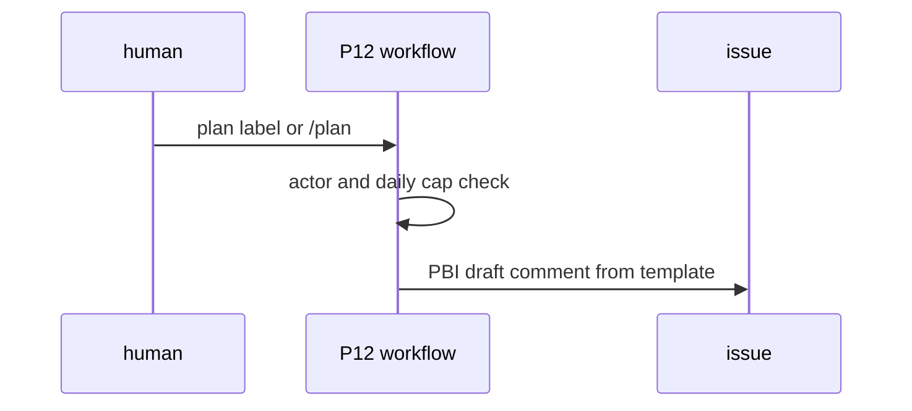
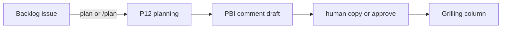

# P12: Planning workflow
- Status: todo
- Area: multi-repo
- Wave: W5
- Block: 3
- Lane: Builder
- Depends on: C03, C04, P05, G01
- proof: gh aw compile --dir workflows --strict workflows/p12-planning.md && make verify
- door: one-way
- one-way gate: Sven's exact yes required (tokens). Rollback: disable workflow via AO03 kill var for P12
## Goal
On label `plan` or human `/plan`, draft a full PBI from [docs/pbi/_template.md](../_template.md) as an issue comment (Goal, DoD, `proof:`, `door:`, Technical design, mermaid). Human copies into `docs/pbi/` or approves. Max 3 runs per day.
## Context
[LP01](../loops/LP01-delivery-loop.md) plan step. Label actor must be human with write ([LP02](../loops/LP02-event-map.md)). One-way tokens. Does not move board cards.
## Steps
1. Add `workflows/p12-planning.md` with `issues: labeled plan` and `/plan` command trigger.
2. Agent reads `_template.md` and issue context; outputs one comment with all required PBI sections.
3. Cap `max-daily-ai-credits` to enforce 3 runs per day.
4. Staged comment-only first; promote after 3 audited runs and Sven yes.
## Definition of Done
- [ ] Fetches own context with tools and imports (Bar H)
- [ ] `imports:` shared/defaults.md; pinned gh-aw and imports
- [ ] Caps per C03; deterministic pre-check noop when label actor is bot
- [ ] Comment includes the Technical design section with a fenced sequence mermaid block
- [ ] Max 3 runs per day enforced
- [ ] `workflow_dispatch` and label or slash after promotion path documented
- [ ] Trial on X01 issue; three audited runs; AIC in Evidence
- [ ] `make verify` pass
- [ ] X07 benchmark score at or above baseline (5+ cases)
## Technical design
- Components and files: `workflows/p12-planning.md`, import `docs/pbi/_template.md` via read tool, `shared/defaults.md`
- Interfaces: trigger `plan` label and `command: /plan`; safe-output `create-comment` only; workflow frontmatter human actor check
- Sequence:

- Failure modes: bot label noop; daily cap skips with comment
- Security: no repo file writes; comment only; threat detection on
- Observability: B01 run link in comment footer per reporting.md
- Cost: Tier M per run (unverified); max 3 per day
- Rollback: AO03 kill var for P12
- Proof: sample comment matching template sections
- Door: one-way (agent tokens on issues)
## Evidence
(verify log, sample plan comment link, three-run AIC)
## Flow

## Named asks for Sven
Sven yes before live label trigger after staged runs
## Cost
Tier M, ~40-60 AIC per plan draft (unverified)
## Sources
- Plan v3.8 P12; [LP01-delivery-loop.md](../loops/LP01-delivery-loop.md)
