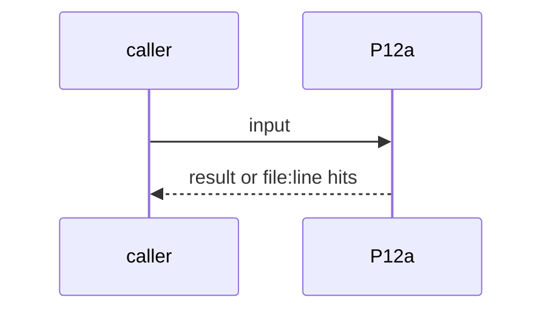
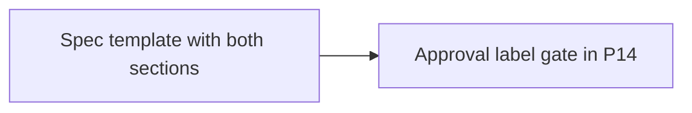

# P12a: Spec has product and tech sections, human approval before pick-up
- Status: todo
- Area: multi-repo
- Wave: W3
- Block: 3
- Lane: Builder
- Depends on: P12, P14
- proof: spec fixture without a product or tech section fails; P14 does not pick up an issue without the approval label
- door: two-way
- triage: build
- feedback: spec template check plus P14 label fixture
- harness: gh-aw, engine copilot via shared/defaults.md (when built)
- review-input: diff + this PBI + DoD (+ linked spec) + PR description, never builder session logs (PA6)
- kind: skill
- Source: D14 https://x.com/BHolmesDev/status/2106510336413012463 https://www.warp.dev/blog/software-factory-build-guide
## Goal
A P12 spec has a product section (user experience) and a tech section (fit in the architecture). A human approval label is required before P14 picks it up; revisions loop back to the spec.
## Context
Warp build guide: the spec agent writes PRODUCT.md and TECH.md and a human approves before code. Ben Holmes' diagram: human review of specs, revisions loop to the spec agent. Not built in PR #4: docs only, nothing enabled (PA9).
## Steps
1. Spec template with both sections.
2. Approval label gate in P14.
## Definition of Done
- [ ] Spec check red without either section
- [ ] P14 skips an unapproved spec
- [ ] Every Bar H line from [README.md](../README.md#bar-h-every-workflow-pbi) when the workflow ships
## Technical design
- Components and files: P12 workflow and template, P14 gate
- Module boundary: two spec sections and one label
- Interfaces: label name in P14
- Sequence:

- Failure modes: No label means no pick-up
- Security: Spec text is untrusted input
- Observability: P05 board state
- Cost: per P12 run
- Rollback: Drop the label gate
- Proof: same as proof: above
- Door: two-way (revert is one commit)
## Evidence
(todo)
## Flow

## Named asks for Sven
none
## Cost
per P12 run
## Sources
- [Ben Holmes, factory loop](https://x.com/BHolmesDev/status/2106510336413012463)
- [Warp blog, software factory build guide](https://www.warp.dev/blog/software-factory-build-guide)
- Strategy id list v3.12 (aw-final-ids.md), url-learnings.md D14
