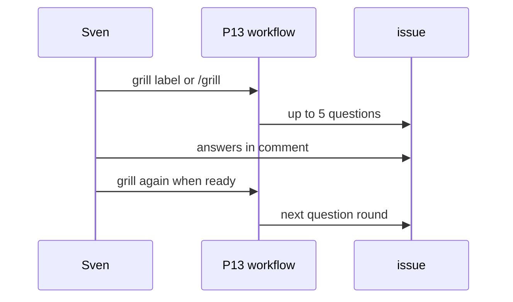
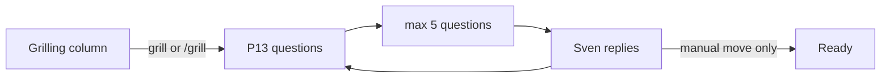

# P13: Grilling workflow
- Status: todo
- Area: multi-repo
- Wave: W5
- Block: 3
- Lane: Builder
- Depends on: C03, C04, O01, O02, O03, P05, G01
- proof: gh aw compile --dir workflows --strict workflows/p13-grilling.md && ./scripts/verify.sh
- door: one-way
- one-way gate: Sven's exact yes required (tokens). Rollback: disable workflow via AO03 kill var for P13
## Goal
Gist point 27: on label `grill` or human `/grill`, post one round of at most 5 questions on goal, DoD, and edge cases. Wait for Sven's reply before the next round. Never moves a card to Ready.
## Context
[LP01](../loops/LP01-delivery-loop.md) grill step. Human actor required for label ([LP02](../loops/LP02-event-map.md)). One-way tokens.
## Steps
1. Add `workflows/p13-grilling.md` with `grill` label and `/grill` command.
2. Agent posts up to 5 questions per run; stores state in issue comments thread.
3. Next round only after Sven comment reply detected in pre-step.
4. Explicit guard: no Projects API moves to Ready.
## Definition of Done
- [ ] Fetches own context with tools and imports (Bar H)
- [ ] `imports:` shared/defaults.md; pinned gh-aw and imports
- [ ] At most 5 questions per run; waits for Sven reply between rounds
- [ ] Never moves Project card to Ready
- [ ] Bot label actor noop
- [ ] Trial issue on board; three audited runs; AIC in Evidence
- [ ] `scripts/verify.sh` pass
- [ ] X07 benchmark score at or above baseline (5+ cases)
## Technical design
- Components and files: `workflows/p13-grilling.md`, `shared/defaults.md`, issue comment thread as state
- Interfaces: `grill` label and `/grill`; safe-output comment; concurrency per issue
- Sequence:

- Failure modes: run without Sven reply since last round noop with note
- Security: comment only; untrusted issue body as data
- Observability: B01 audit per round
- Cost: Tier S to M per round (unverified)
- Rollback: AO03 kill var for P13
- Proof: issue thread with two rounds in Evidence
- Door: one-way (agent tokens)
## Evidence
(verify log, grilling issue link, three-run AIC)
## Flow

## Named asks for Sven
Sven yes before live grill trigger after staged runs
## Cost
Tier S, ~15-30 AIC per round (unverified)
## Sources
- Plan v3.8 P13; gist review point 27; [LP01-delivery-loop.md](../loops/LP01-delivery-loop.md)
