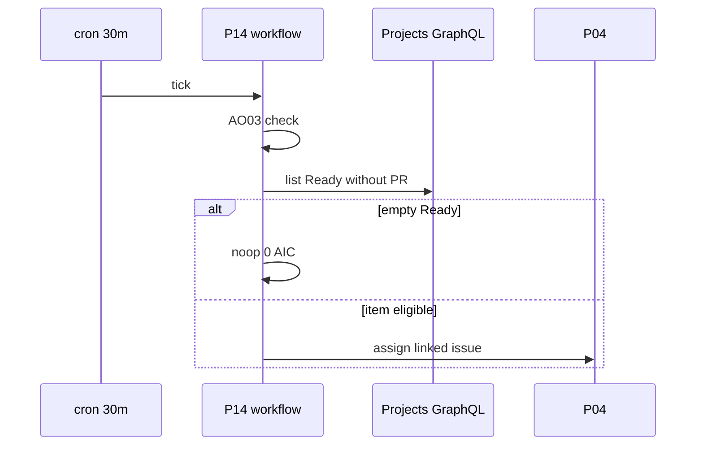
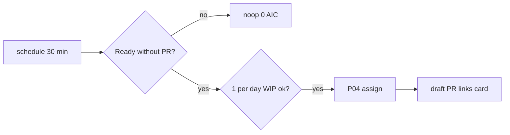

# P14: Board pick-up (Ready to Copilot)
- Status: todo
- Area: multi-repo
- Wave: W5
- Block: 5
- Lane: Builder
- Depends on: P05, P04, O04, O05, AO03, G01
- proof: gh aw compile --dir workflows --strict workflows/p14-board-pick-up.md && ./scripts/verify.sh
- door: one-way
- one-way gate: Sven's exact yes required before schedule trigger stays on (B5). Rollback: disable schedule workflow; AO03 kill var for P14
- triage: park (schedule off until B5 Sven yes)
- feedback: gh aw compile --dir workflows --strict workflows/p14-board-pick-up.md && ./scripts/verify.sh
- harness: gh-aw engine
- review-input: diff + this PBI + DoD (+ linked spec) + PR description, never builder session logs
- kind: skill
- Source: PA8 (pre-link PBI, G05 link refresh in PR #11, origin in its Sources) https://github.com/svennijhuis/agentic-workflows/pull/11
## Goal
Poll every 30 minutes (`schedule`) because GitHub Actions has no Projects v2 event trigger. Deterministic pre-step: `gh api graphql` lists Ready items without a linked PR (0 AIC when Ready is empty). Only cards Sven moved to Ready; hand issue to [P04](P04-research-plan-assign-copilot.md), WIP 1, max 1 pick-up per day. Draft PR links back to the card. Revisit webhook at org switch ([G05](../done/G05-org-only-appendix.md)).
## Context
[LP01](../loops/LP01-delivery-loop.md) pick-up step. The board pick-up is a 30 min poll with a deterministic noop pre-step (0 AIC when Ready is empty). It is a scheduled workflow, so it stays OFF until Sven's exact yes (one-way door, B5), and its Actions minutes (48 runs a day) count toward the measured cost.
## Steps
1. Add `workflows/p14-board-pick-up.md` with `schedule: '*/30 * * * *'` disabled until B5 gate.
2. Pre-step GraphQL with `BOARD_TOKEN` (deterministic step only, never the agent job): Ready column items without linked PR; noop when empty.
3. For each eligible item (max 1 per day): call P04 assign path with issue number from linked issue.
4. Enforce WIP 1 open auto-fix PR per repo shared with P04 and M05.
## Definition of Done
- [ ] Schedule 30 min poll documented; workflow off until Sven B5 yes
- [ ] GraphQL pre-step noop when no Ready items (0 AIC)
- [ ] Only the pre-step reads `BOARD_TOKEN`; the agent job has no board token
- [ ] Only Ready cards placed by Sven; max 1 pick-up per day
- [ ] Hands off to P04; draft PR links to Project item
- [ ] `imports:` shared/defaults.md; caps; AO03 pre-step
- [ ] Three audited runs with measured Actions minutes and AIC in Evidence
- [ ] `scripts/verify.sh` pass
- [ ] X07 benchmark score at or above baseline (5+ cases)
## Technical design
- Components and files: `workflows/p14-board-pick-up.md`, Project id from masked var, shared WIP counter with P04
- Module boundary: the GraphQL Ready pre-step is the interface; P04 assign is the deep handoff behind it
- Interfaces: `schedule` cron; deterministic `gh api graphql`; dispatch or reusable workflow call to P04 assign job
- Sequence:

- Failure modes: GraphQL auth failure fails job; daily cap skips with log
- Security: `BOARD_TOKEN` (shared with P05, Projects read and write on the user board only) is used only by the deterministic GraphQL pre-step, never by the agent job; no card moves by agent
- Observability: pick-up log line with item id and issue number
- Cost: 48 scheduled runs per day mostly noop; agent cost only on pick-up
- Rollback: turn off schedule; AO03 kill var
- Proof: dry-run GraphQL query output with empty Ready
- Door: one-way (schedule and assign handoff; B5 Sven yes to enable)
## Evidence
(verify log, schedule enablement note, GraphQL noop log, pick-up run link)
## Flow

## Named asks for Sven
Exact yes before enabling schedule trigger (one-way). Board token: the same `BOARD_TOKEN` as P05 (README named ask, first asked in B3), no separate token
## Cost
48 Actions runs per day at mostly 0 AIC; plus P04 chain when pick-up fires
## Sources
- Plan v3.8b board poll decision; [LP01-delivery-loop.md](../loops/LP01-delivery-loop.md), [LP02-event-map.md](../loops/LP02-event-map.md)
