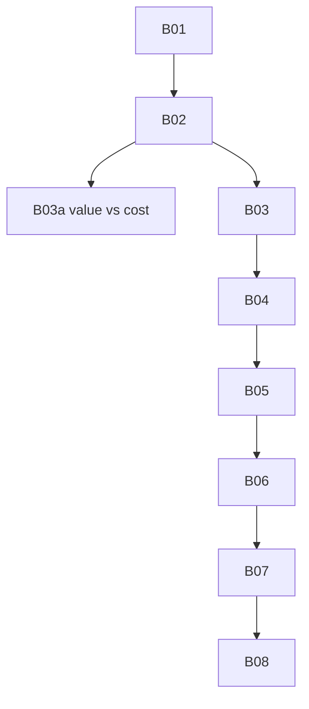

# observability: overview

**Purpose:** Logs, spend, OTLP, health, security reporting.

## PBIs

- [B01: B01-logs-audit-session-runbook](B01-logs-audit-session-runbook.md)
- [B02: B02-weekly-spend-overview](B02-weekly-spend-overview.md)
- [B03a: B03a-value-vs-cost](B03a-value-vs-cost.md) (Block 3 kill rule; full B03 in Block 5)
- [B03: B03-outcomes-impact](B03-outcomes-impact.md)
- [B04: B04-open-telemetry](B04-open-telemetry.md)
- [B05: B05-spend-forecast](B05-spend-forecast.md)
- [B06: B06-ab-experiments](B06-ab-experiments.md)
- [B07: B07-workflow-health-monitor](B07-workflow-health-monitor.md)
- [B08: B08-firewall-security-observability-report](B08-firewall-security-observability-report.md)

## Dependency sketch

