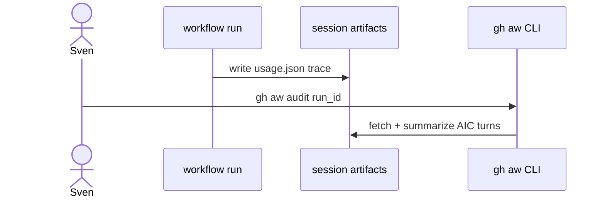

# B01: Logs + audit + session runbook
- Status: todo
- Area: observability
- Wave: PR 0
- Block: 3
- Lane: Cursor CLI
- Depends on: C01
- proof: ./scripts/verify.sh
- door: one-way
- one-way gate: Sven's exact yes required (named ask in its block). Rollback: disable observability workflow in trial repo
## Goal
Define operator runbook for gh aw logs, gh aw audit, session artifacts, and usage.json interpretation across personal repos.
## Context
Unified agent session spec governs artifact layout. Until Actions billing works (Q0), local verify on SHA complements run forensics.
## Steps
1. Document CLI commands: logs, audit, outcomes flags.
2. Map artifact sets (usage.json, traces) to troubleshooting steps (D07).
3. Require first 3 runs audit per workflow Bar H.
4. Optional: gh-aw as MCP server read-only for logs.
## Definition of Done
- [ ] Runbook section in docs/reference for operators.
- [ ] Bar H audit of first 3 runs checklist linked from F00 workflows.
- [ ] Evidence template includes run URLs and AIC lines.
## Evidence
(commands, logs, verify log on SHA, run links)
## Flow

## Named asks for Sven
(Q0 (Actions billing blocks CI; use verify log on SHA))
## Cost
n/a
## Sources
- https://github.github.com/gh-aw/reference/audit/
- https://github.github.com/gh-aw/reference/artifacts/
- https://github.github.com/gh-aw/specs/unified-agent-session-specification/
- https://github.github.com/gh-aw/reference/gh-aw-as-mcp-server/
