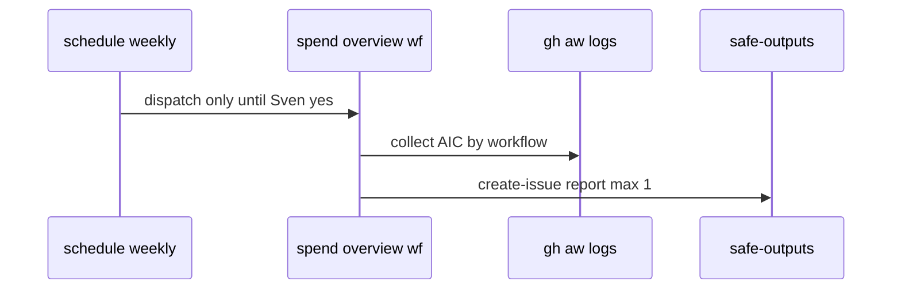

# B02: Weekly spend overview
- Status: todo
- Area: observability
- Wave: PR 0
- Block: 3
- Lane: Builder
- Depends on: B01, F04, C03
- proof: gh aw audit <run-id> on weekly spend workflow; CSV in B02 report path
- door: one-way
- one-way gate: Sven's exact yes required (named ask in its block). Rollback: disable weekly spend workflow
## Goal
Implement or document a weekly AI Credits spend overview workflow aligned with F04 cost tracker and Copilot Pro monthly pool.
## Context
Suggested caps: 50 AIC/run, 200/day (unverified). Pro plan 1,500 AIC/month. Weekly rollup helps catch drift before caps fail. Embeds [X07](../testing/X07-workflow-benchmark.md) benchmark tables/CSV and [B03a](B03a-value-vs-cost.md) value vs cost rows.
## Steps
1. Import shared/defaults caps and document measurement method.
2. Aggregate gh aw logs or outcomes across repos Sven lists.
3. Safe-output weekly issue or comment with spend table (report-only first).
4. Compare to tier bands S/M/L/XL and adjust caps after 3 runs.
## Definition of Done
- [ ] Bar H: shared defaults import, pinned gh-aw, caps, staged first, dedupe, min-integrity, network allowlist, tool allowlist, threat detection, on.roles, reporting format, trial-repo, 3-run audit, measured cost.
- [ ] workflow_dispatch + report-only before any write.
- [ ] Issue title prefix [aic-weekly] with group-by-day dedupe.
## Evidence
(commands, logs, verify log on SHA, run links)
## Flow

## Named asks for Sven
(Q4 (Copilot plan and budget))
## Cost
Tier S, <=20 AIC per run (unverified)
## Sources
- https://github.github.com/gh-aw/reference/audit/
- https://github.github.com/gh-aw/reference/billing/
- https://github.github.com/gh-aw/specs/ai-credits-specification/
- https://github.github.com/gh-aw/blog/2026-06-08-migrating-from-effective-tokens-to-ai-credits/
