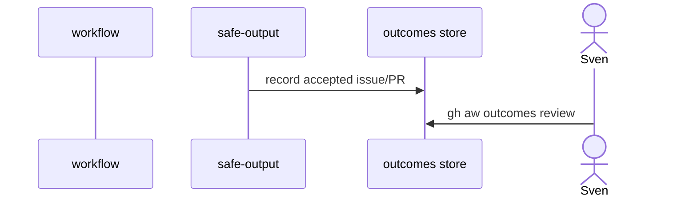

# B03: Outcomes + impact
- Status: todo
- Area: observability
- Wave: PR 0
- Block: 5
- Lane: Cursor CLI
- Depends on: B01, O01
- proof: test -f docs/pbi/observability/B03-outcomes-impact.md && ./scripts/verify.sh
- door: two-way
## Goal
Document gh aw outcomes and measuring impact guidance to prove workflows save time without vanity metrics.
## Context
Outcomes tie safe-output acceptance to value. Block 3 economics use [B03a](B03a-value-vs-cost.md); this PBI is the full impact study in Block 5. Feeds F12 metrics and governance reviews. Benchmark inputs: [X07](../testing/X07-workflow-benchmark.md).
## Steps
1. Document outcomes CLI and acceptance signals.
2. Link measuring-impact guide to G01 promotion criteria.
3. Define minimal outcome set per NOW workflow (F01-F07 etc.).
## Definition of Done
- [ ] Each NOW workflow PBI lists expected outcome type.
- [ ] Promotion on G01 ladder requires outcome evidence or explicit waiver.
## Evidence
(commands, logs, verify log on SHA, run links)
## Flow

## Named asks for Sven
(none)
## Cost
n/a
## Sources
- https://github.github.com/gh-aw/reference/outcomes/
- https://github.github.com/gh-aw/guides/measuring-impact/
- https://github.github.com/gh-aw/gallery/metrics-analytics/
