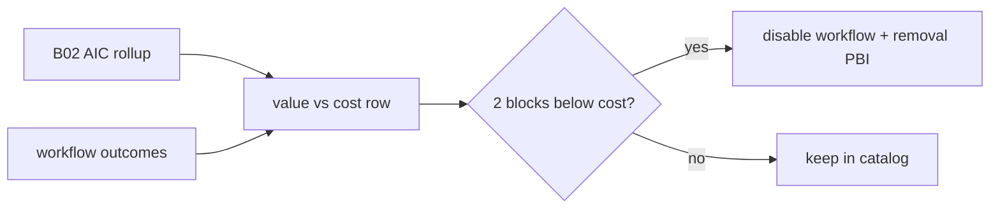

# B03a: Value vs cost (per workflow)
- Status: todo
- Area: observability
- Wave: W3
- Block: 3
- Lane: Builder
- Depends on: B02
- proof: gh aw audit <run-id> on value-vs-cost report; table row present in B02 weekly markdown + CSV for each NOW workflow
- door: one-way
- one-way gate: Sven's exact yes required (named ask in its block). Rollback: stop value vs cost job; revert kill-rule disable if false positive
## Goal
For each catalog workflow in the Block 3 NOW set, maintain one table row comparing AIC spend (from [B02](B02-weekly-spend-overview.md)) to outcome signals (issues triaged, PR review comments kept, noop rate). Apply kill rule: two consecutive blocks where value is below cost disables the workflow and opens a PBI to remove it. Full outcomes narrative stays in [B03](B03-outcomes-impact.md) (Block 5).
## Context
Gist review point 31 (measure skill impact). Split from B03 so Block 3 exit can gate shipping workflows on economics. The value side of the kill rule is the [X07](../testing/X07-workflow-benchmark.md) benchmark score (same case set as cost per AIC from B02).
## Steps
1. Define value columns (accepted outcomes) and cost columns (AIC from B02 rollup) per workflow id.
2. Publish weekly row in B02 report attachment (markdown table + CSV).
3. Document kill rule: below-cost for block n and block n+1 triggers disable + removal PBI in next findings block.
4. Safe-output report-only first; no repo writes until staged path proven.
5. Cross-link B02 and B03; note full B03 impact study remains Block 5.
## Definition of Done
- [ ] One value vs cost row per NOW workflow in B02 weekly output
- [ ] Kill rule documented and wired to governance (disable workflow, open removal PBI)
- [ ] Linked from README Block 3 exit criteria and observability overview
- [ ] Back link from [B02](B02-weekly-spend-overview.md) and [B03](B03-outcomes-impact.md)
- [ ] Mermaid flow present
## Evidence
(sample B02 markdown table + CSV with value/cost columns; kill-rule drill on test workflow)
## Flow

## Named asks for Sven
Cost cap per workflow OK (Block 3); confirm kill rule thresholds
## Cost
Tier S, report-only aggregation (unverified)
## Sources
- Plan v3.6 A6 B03a
- [gist-review.md](../gist-review.md)
- Related: [X07-workflow-benchmark.md](../testing/X07-workflow-benchmark.md)
