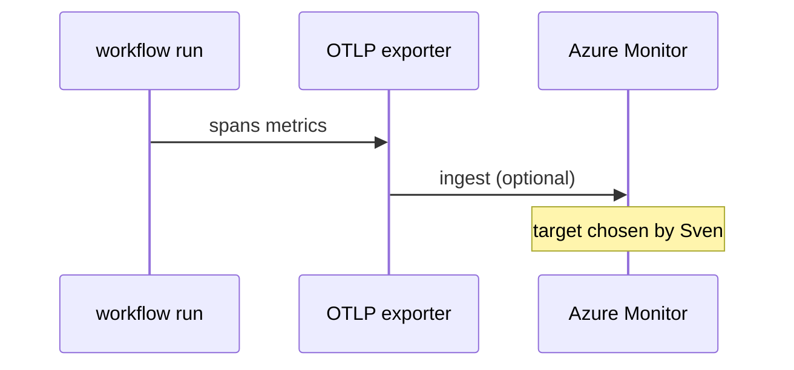

# B04: OpenTelemetry
- Status: todo
- Area: observability
- Wave: PR 0
- Block: 5
- Lane: Builder
- Depends on: B01
- proof: ./scripts/verify.sh
- door: two-way
## Goal
Document optional OTLP export for workflow runs to Azure Monitor or other backends Sven chooses.
## Context
OpenTelemetry attributes are standardized in gh-aw. Export is optional until Q5/Q5 repo map and B04 OTLP target are decided.
## Steps
1. Summarize open-telemetry reference and attribute list.
2. Document compiler/env hooks without committing endpoints to files.
3. Plan trial export on X01 test repo only first.
## Definition of Done
- [ ] OTLP endpoint supplied via secret or variable only.
- [ ] No PII or tokens in span attributes.
- [ ] Trial repo proof before production repos.
## Evidence
(commands, logs, verify log on SHA, run links)
## Flow

## Named asks for Sven
(B04 (OTLP target), Q5 (App Insights vs Log Analytics))
## Cost
n/a (export infra); agent cost unchanged
## Sources
- https://github.github.com/gh-aw/reference/open-telemetry/
- https://github.github.com/gh-aw/reference/open-telemetry-attributes/
