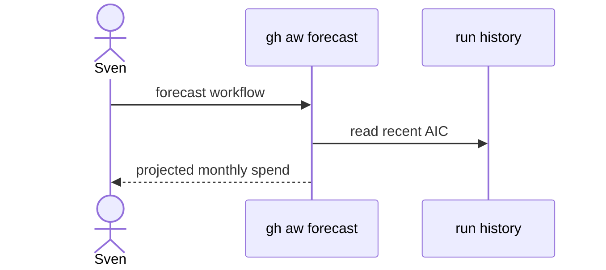

# B05: Spend forecast
- Status: todo
- Area: observability
- Wave: PR 0
- Block: 5
- Lane: Cursor CLI
- Depends on: B02, C03
- proof: ./scripts/verify.sh
- door: two-way
## Goal
Document gh aw forecast capability for projecting monthly AIC spend from recent runs.
## Context
Forecast spec supports admission decisions before enabling schedules like M03 hourly.
## Steps
1. Summarize forecast command spec and inputs.
2. Link forecast to M03 go/no-go after measured hourly cost.
3. Document cooperative daily cap overshoot caveat.
## Definition of Done
- [ ] Runbook includes forecast example before schedule promotion.
- [ ] Forecast output stored in Evidence section template.
## Evidence
(commands, logs, verify log on SHA, run links)
## Flow

## Named asks for Sven
(Q4)
## Cost
n/a
## Sources
- https://github.github.com/gh-aw/specs/forecast-specification/
- https://github.github.com/gh-aw/reference/cost-management/
