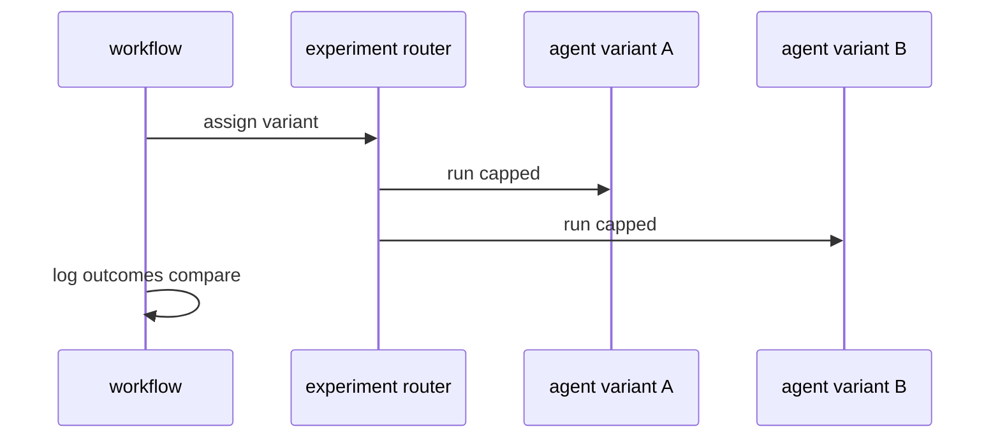

# B06: A/B experiments
- Status: todo
- Area: observability
- Wave: PR 0
- Block: 5
- Lane: Cursor CLI
- Depends on: B03, C03
- proof: ./scripts/verify.sh
- door: two-way
## Goal
Document experimental A/B framework for comparing prompts or models with guardrails.
## Context
Experiments can double cost. Personal catalog uses experiments only on X01 test repo with explicit caps.
## Steps
1. Summarize experiments specification.
2. Require workflow_dispatch and max 2 variants.
3. Forbid experiments on production consumer repos without Sven yes.
## Definition of Done
- [ ] Experiment design template in testing folder cross-link.
- [ ] Cost tier XL blocked without cap raise.
## Evidence
(commands, logs, verify log on SHA, run links)
## Flow

## Named asks for Sven
(none)
## Cost
Tier XL, >150 AIC if both variants run (unverified)
## Sources
- https://github.github.com/gh-aw/experimental/experiments/
- https://github.github.com/gh-aw/experimental/experiments-specification/
