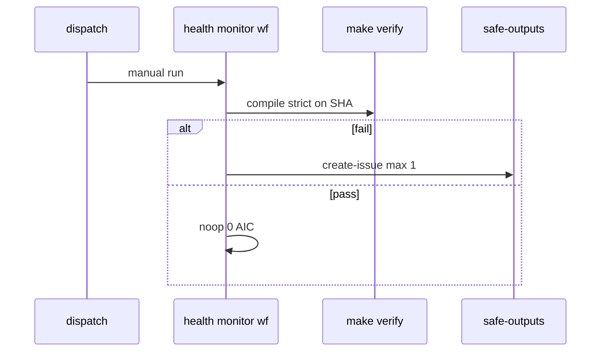

# B07: Workflow health monitor
- Status: todo
- Area: observability
- Wave: PR 0
- Block: 5
- Lane: Builder
- Depends on: B01, M01
- proof: make verify
- door: one-way
- one-way gate: Sven's exact yes required (named ask in its block). Rollback: disable health monitor workflow
## Goal
Document a catalog health workflow that detects failing compiles, stale lock files, and cap breaches across installed workflows.
## Context
Complements M01 exception watcher (Azure) with GitHub-side catalog health. Dispatch-only until proven.
## Steps
1. Define health signals: compile --strict, compile --strict clean, recent run failures.
2. Safe-output issue to catalog repo with dedupe.
3. Integrate with make verify when Q0 blocks Actions.
## Definition of Done
- [ ] Bar H items satisfied when workflow lands (Builder).
- [ ] workflow_dispatch first; schedule only after Sven yes.
- [ ] Health issue format from shared/reporting.md.
## Evidence
(commands, logs, verify log on SHA, run links)
## Flow

## Named asks for Sven
(Q0)
## Cost
Tier S, <=20 AIC (unverified)
## Sources
- https://github.github.com/gh-aw/patterns/monitor-ops/
- https://github.github.com/gh-aw/reference/workflow-linters/
