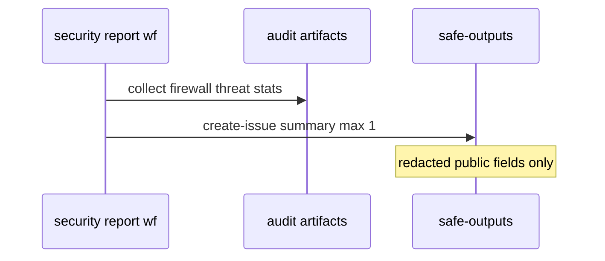

# B08: Firewall + security observability report
- Status: todo
- Area: observability
- Wave: PR 0
- Block: 5
- Lane: Builder
- Depends on: B01, S01, S03
- proof: ./scripts/verify.sh
- door: two-way
## Goal
Periodic report summarizing network denials, threat detection hits, and integrity filtering stats for catalog workflows.
## Context
Supports security posture review without reading every run log. Report-only issue output first.
## Steps
1. Aggregate threat detection and firewall logs from audit artifacts.
2. Redact sensitive paths and tokens from report body.
3. Link to S01 network guide and S03 protected files.
## Definition of Done
- [ ] Bar H when implemented.
- [ ] Report-only staged mode until Sven promotes.
- [ ] No secret values in report markdown.
## Evidence
(commands, logs, verify log on SHA, run links)
## Flow

## Named asks for Sven
(none)
## Cost
Tier M, 20-60 AIC (unverified)
## Sources
- https://github.github.com/gh-aw/guides/network-configuration/
- https://github.github.com/gh-aw/reference/threat-detection/
- https://github.github.com/gh-aw/reference/integrity/
