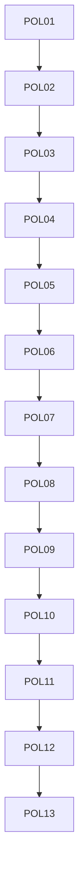

# policies: overview

**Purpose:** Policy-as-code checks run by `scripts/verify.sh`.

## PBIs

- [POL01: POL01-pinned-versions-only](POL01-pinned-versions-only.md)
- [POL02: POL02-cost-caps-required](POL02-cost-caps-required.md)
- [POL03: POL03-staged-report-only-before-writes](POL03-staged-report-only-before-writes.md)
- [POL04: POL04-no-secrets-in-files](POL04-no-secrets-in-files.md)
- [POL05: POL05-min-integrity-required](POL05-min-integrity-required.md)
- [POL06: POL06-network-allowlist-no-wildcard](POL06-network-allowlist-no-wildcard.md)
- [POL07: POL07-tool-mcp-bash-allowlists](POL07-tool-mcp-bash-allowlists.md)
- [POL08: POL08-safe-output-max-on-every-output](POL08-safe-output-max-on-every-output.md)
- [POL09: POL09-rate-limits-concurrency-cooldown](POL09-rate-limits-concurrency-cooldown.md)
- [POL10: POL10-who-can-trigger](POL10-who-can-trigger.md)
- [POL11: POL11-least-permissions-read-only-agent](POL11-least-permissions-read-only-agent.md)
- [POL12: POL12-explicit-allowed-repos-target-repo](POL12-explicit-allowed-repos-target-repo.md)
- [POL13: POL13-threat-detection-never-off](POL13-threat-detection-never-off.md)
- [POL14: POL14-no-merge-pull-request-unsafe-pr-target](POL14-no-merge-pull-request-unsafe-pr-target.md)
- [POL15: POL15-timeouts-required](POL15-timeouts-required.md)
- [POL16: POL16-house-style-no-em-dash-fixed-report](POL16-house-style-no-em-dash-fixed-report.md)
- [POL17: POL17-lock-file-committed-fresh](POL17-lock-file-committed-fresh.md)
- [POL18: POL18-gh-aw-env-runtime-policy-vars](POL18-gh-aw-env-runtime-policy-vars.md)
- [POL19: POL19-no-force-push](POL19-no-force-push.md)
- [POL20: POL20-no-tokens-in-markdown](POL20-no-tokens-in-markdown.md)
- [POL21: POL21-copilot-requests-none](POL21-copilot-requests-none.md)
- [POL22: POL22-pr-review-comment-only](POL22-pr-review-comment-only.md)
- [POL23: POL23-no-tautological-checks](POL23-no-tautological-checks.md)

## Dependency sketch

