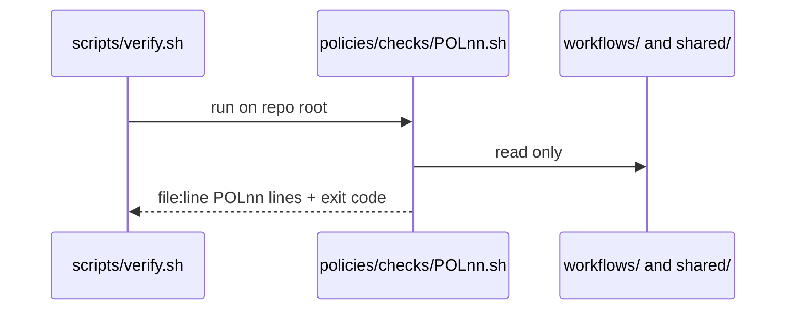
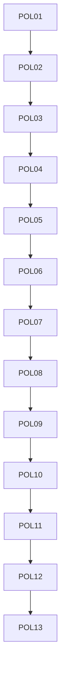

# policies: overview

**Purpose:** Policy-as-code checks run by `scripts/verify.sh`.

## PBIs

- [POL01: POL01-pinned-versions-only](../done/POL01-pinned-versions-only.md)
- [POL02: POL02-cost-caps-required](../done/POL02-cost-caps-required.md)
- [POL03: POL03-staged-report-only-before-writes](../done/POL03-staged-report-only-before-writes.md)
- [POL04: POL04-no-secrets-in-files](../done/POL04-no-secrets-in-files.md)
- [POL05: POL05-min-integrity-required](../done/POL05-min-integrity-required.md)
- [POL06: POL06-network-allowlist-no-wildcard](../done/POL06-network-allowlist-no-wildcard.md)
- [POL07: POL07-tool-mcp-bash-allowlists](../done/POL07-tool-mcp-bash-allowlists.md)
- [POL08: POL08-safe-output-max-on-every-output](../done/POL08-safe-output-max-on-every-output.md)
- [POL09: POL09-rate-limits-concurrency-cooldown](../done/POL09-rate-limits-concurrency-cooldown.md)
- [POL10: POL10-who-can-trigger](../done/POL10-who-can-trigger.md)
- [POL11: POL11-least-permissions-read-only-agent](../done/POL11-least-permissions-read-only-agent.md)
- [POL12: POL12-explicit-allowed-repos-target-repo](../done/POL12-explicit-allowed-repos-target-repo.md)
- [POL13: POL13-threat-detection-never-off](../done/POL13-threat-detection-never-off.md)
- [POL14: POL14-no-merge-pull-request-unsafe-pr-target](../done/POL14-no-merge-pull-request-unsafe-pr-target.md)
- [POL15: POL15-timeouts-required](../done/POL15-timeouts-required.md)
- [POL16: POL16-house-style-no-em-dash-fixed-report](../done/POL16-house-style-no-em-dash-fixed-report.md)
- [POL17: POL17-lock-file-committed-fresh](../done/POL17-lock-file-committed-fresh.md)
- [POL18: POL18-gh-aw-env-runtime-policy-vars](../done/POL18-gh-aw-env-runtime-policy-vars.md)
- [POL19: POL19-no-force-push](../done/POL19-no-force-push.md)
- [POL20: POL20-no-tokens-in-markdown](../done/POL20-no-tokens-in-markdown.md)
- [POL21: POL21-copilot-requests-none](../done/POL21-copilot-requests-none.md)
- [POL22: POL22-pr-review-comment-only](../done/POL22-pr-review-comment-only.md)
- [POL23: POL23-no-tautological-checks](../done/POL23-no-tautological-checks.md)

## Shared technical design (POL01-POL23)

All 23 policies share one design. Each POL file repeats it in its own `## Technical design` section with its own row below.

- Components and files: per POL `policies/POLnn.yml` (rule + why), `policies/checks/POLnn.sh`, `test/fixtures/bad/POLnn.md` (exception: POL17 uses folder `test/fixtures/bad/POL17/` with a workflow file plus a stale lock), good coverage in `test/fixtures/good/`.
- Interfaces: a check gets the repo root, prints `file:line POLnn message`, exits 1 on a hit. `scripts/verify.sh` loops all checks.
- Sequence:

- Failure modes: a tautological check that never fails, so POL23 runs each check on its bad fixture and needs exit 1.
- Security: checks are read-only grep or yq, no tokens, no network.
- Observability: one line per hit in verify.sh output, last line `N failures`.
- Cost: 0 AIC (scripts).
- Rollback: remove the check from the verify.sh loop (the policy doc stays).
- Proof: `scripts/verify.sh` lists 23 failures on `test/fixtures/bad/`, 0 on good.
- Door: two-way (POL19 ruleset part is one-way: Sven sets the ruleset).

### Check table (23 rows)

| POL | Check (what the script tests) | Bad fixture |
|---|---|---|
| [POL01](../done/POL01-pinned-versions-only.md) pins | `imports:`/`plugins:` refs are `@<40-hex>` or `@vX.Y.Z` tag, actions by SHA | `test/fixtures/bad/POL01.md`: import `@main` |
| [POL02](../done/POL02-cost-caps-required.md) caps | each `workflows/*.md` own frontmatter has max-ai-credits, max-daily-ai-credits, max-turns, timeout-minutes | `test/fixtures/bad/POL02.md`: caps only in shared |
| [POL03](../done/POL03-staged-report-only-before-writes.md) staged first | new workflow has `staged: true` until listed in `rollout.yml` | `test/fixtures/bad/POL03.md`: write output, not staged |
| [POL04](../done/POL04-no-secrets-in-files.md) no secrets | gitleaks + no `ghp_`/`github_pat_` patterns | `test/fixtures/bad/POL04.md`: fake PAT string |
| [POL05](../done/POL05-min-integrity-required.md) min-integrity | `min-integrity` set | `test/fixtures/bad/POL05.md`: key missing |
| [POL06](../done/POL06-network-allowlist-no-wildcard.md) network | `network.allowed` list, no `*` | `test/fixtures/bad/POL06.md`: `*` |
| [POL07](../done/POL07-tool-mcp-bash-allowlists.md) allowlists | tools, MCP and bash lists explicit | `test/fixtures/bad/POL07.md`: `bash: ["*"]` |
| [POL08](../done/POL08-safe-output-max-on-every-output.md) output max | every safe-output has `max` | `test/fixtures/bad/POL08.md`: create-issue no max |
| [POL09](../done/POL09-rate-limits-concurrency-cooldown.md) rate | concurrency group + schedule not below 1h | `test/fixtures/bad/POL09.md`: `*/5` cron |
| [POL10](../done/POL10-who-can-trigger.md) who triggers | `on.roles` set, skip-bots on | `test/fixtures/bad/POL10.md`: no roles |
| [POL11](../done/POL11-least-permissions-read-only-agent.md) permissions | agent job read-only | `test/fixtures/bad/POL11.md`: `contents: write` |
| [POL12](../done/POL12-explicit-allowed-repos-target-repo.md) repo target | `target-repo`/`allowed-repos` explicit for cross-repo; every `aw.yml` `m05.repos` entry has owner svennijhuis | `test/fixtures/bad/POL12.md`: cross-repo with none; m05.repos entry with another owner |
| [POL13](../done/POL13-threat-detection-never-off.md) threat detection | not `false` | `test/fixtures/bad/POL13.md`: `threat-detection: false` |
| [POL14](../done/POL14-no-merge-pull-request-unsafe-pr-target.md) no merge | no merge-pull-request, no `pull_request_target` with checkout of head | `test/fixtures/bad/POL14.md`: merge output |
| [POL15](../done/POL15-timeouts-required.md) timeouts | `timeout-minutes` set | `test/fixtures/bad/POL15.md`: missing |
| [POL16](../done/POL16-house-style-no-em-dash-fixed-report.md) house style | no em dash, report uses shared/reporting.md | `test/fixtures/bad/POL16.md`: em dash |
| [POL17](../done/POL17-lock-file-committed-fresh.md) lock fresh | lock committed, compile gives no diff | `test/fixtures/bad/POL17/`: `workflow.md` plus stale `workflow.lock.yml` |
| [POL18](../done/POL18-gh-aw-env-runtime-policy-vars.md) runtime vars | required `gh aw env` vars documented in workflow | `test/fixtures/bad/POL18.md`: undocumented var |
| [POL19](../done/POL19-no-force-push.md) no force push | ruleset export has non_fast_forward; scripts have no `push -f`/`--force` | `test/fixtures/bad/POL19.md`: `git push --force` |
| [POL20](../done/POL20-no-tokens-in-markdown.md) no tokens in md | secret-pattern scan on `**/*.md` | `test/fixtures/bad/POL20.md`: token in doc |
| [POL21](../done/POL21-copilot-requests-none.md) copilot-requests | `copilot-requests: none` | `test/fixtures/bad/POL21.md`: key missing |
| [POL22](../done/POL22-pr-review-comment-only.md) review COMMENT only | submit-pull-request-review event is COMMENT | `test/fixtures/bad/POL22.md`: APPROVE |
| [POL23](../done/POL23-no-tautological-checks.md) no tautology | every POL check exits 1 on its bad fixture | `test/fixtures/bad/POL23.md`: check that always passes |

## Dependency sketch

