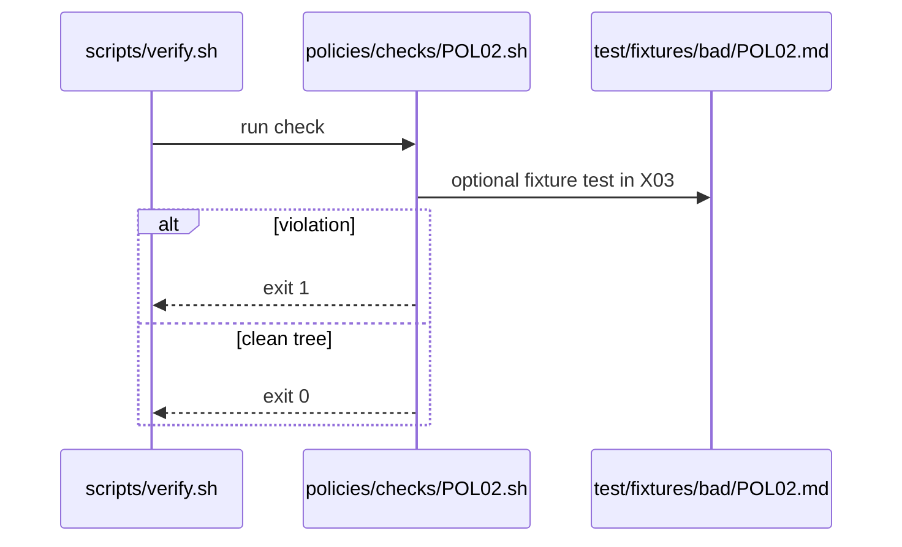

# POL02: Cost caps required
- Status: todo
- Area: policies
- Wave: W1
- Block: 1
- Lane: Cursor CLI
- Depends on: C01, C03
- proof: bash policies/checks/POL02.sh test/fixtures/bad/POL02.md (must exit 1); bash policies/checks/POL02.sh test/fixtures/good/POL02.md (exit 0); ./scripts/verify.sh includes POL02
- door: two-way
## Goal
Encode cost caps required as policy-as-code: `policies/POL02.yml`, gate script `policies/checks/POL02.sh`, and bad fixture `test/fixtures/bad/POL02.md`, enforced by C01.
## Context
Every agentic workflow must set `max-ai-credits` and `max-daily-ai-credits` below platform defaults. Starting catalog suggestion: 50 per run, 200 per day (unverified until measured). Personal account catalog; org-ready rulesets in G05 may mirror these checks later.

Policy text: No workflow may omit AI credit caps. Values must be present in shared defaults or explicit workflow frontmatter after merge.

`policies/checks/POL02.sh` behaviour: Parse workflow frontmatter and shared defaults import chain; fail if either cap missing or above policy ceiling defined in `policies/POL02.yml`.

Bad fixture `test/fixtures/bad/POL02.md`: Workflow with defaults import removed and no caps.
## Steps
1. Write `policies/POL02.yml` with machine-readable rules.
2. Implement `policies/checks/POL02.sh` (bash, exit codes, clear stderr).
3. Add `test/fixtures/bad/POL02.md` triggering a single failure.
4. Add matching good coverage in `test/fixtures/good/` where needed.
5. Register check in `scripts/verify.sh`.
## Definition of Done
- [ ] Policy YAML, check script, and bad fixture exist for POL02
- [ ] `policies/checks/POL02.sh` fails on bad fixture and passes on good catalog
- [ ] Policy text included in this PBI and in `shared/policies/` or `policies/` doc
- [ ] Gate log on SHA shows POL02 executed
## Evidence
(commands, logs, verify log on SHA, run links)
## Flow

## Named asks for Sven
none
## Cost
n/a
## Sources
- https://github.github.com/gh-aw/guides/sharing-workflows/
- https://github.github.com/gh-aw/reference/auth/
- https://github.github.com/gh-aw/reference/cost-management/
- https://github.github.com/gh-aw/reference/imports/
- https://github.github.com/gh-aw/reference/engines/copilot/
- https://github.github.com/svennijhuis/agentic-workflows
