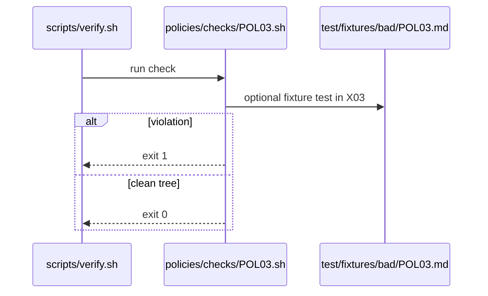

# POL03: Staged and report-only before writes
- Status: todo
- Area: policies
- Wave: W1
- Block: 1
- Lane: Cursor CLI
- Depends on: C01, O02
- proof: bash policies/checks/POL03.sh test/fixtures/bad/POL03.md (must exit 1); bash policies/checks/POL03.sh test/fixtures/good/POL03.md (exit 0); ./scripts/verify.sh includes POL03
- door: two-way
## Goal
Encode staged and report-only before writes as policy-as-code: `policies/POL03.yml`, gate script `policies/checks/POL03.sh`, and bad fixture `test/fixtures/bad/POL03.md`, enforced by C01.
## Context
New or changed workflows must ship `workflow_dispatch` plus staged or report-only mode before any safe-output write to issues or PRs goes to production. Personal account catalog; org-ready rulesets in G05 may mirror these checks later.

Policy text: Production write outputs require prior staged/report-only runs with evidence in the owning PBI. No scheduled or token-spending automation goes live without Sven explicit yes.

`policies/checks/POL03.sh` behaviour: For each catalog workflow, verify `on.workflow_dispatch` exists and write-type safe-outputs are gated by `staged: true` or report-only equivalent unless PBI lists an approved exception.

Bad fixture `test/fixtures/bad/POL03.md`: Workflow with create-issue on push only and no dispatch path.
## Steps
1. Write `policies/POL03.yml` with machine-readable rules.
2. Implement `policies/checks/POL03.sh` (bash, exit codes, clear stderr).
3. Add `test/fixtures/bad/POL03.md` triggering a single failure.
4. Add matching good coverage in `test/fixtures/good/` where needed.
5. Register check in `scripts/verify.sh`.
## Definition of Done
- [ ] Policy YAML, check script, and bad fixture exist for POL03
- [ ] `policies/checks/POL03.sh` fails on bad fixture and passes on good catalog
- [ ] Policy text included in this PBI and in `shared/policies/` or `policies/` doc
- [ ] Gate log on SHA shows POL03 executed
## Evidence
(commands, logs, verify log on SHA, run links)
## Flow

## Named asks for Sven
none
## Cost
n/a
## Sources
- https://github.github.com/gh-aw/guides/sharing-workflows/
- https://github.github.com/gh-aw/reference/auth/
- https://github.github.com/gh-aw/reference/cost-management/
- https://github.github.com/gh-aw/reference/imports/
- https://github.github.com/gh-aw/reference/engines/copilot/
- https://github.github.com/svennijhuis/agentic-workflows
