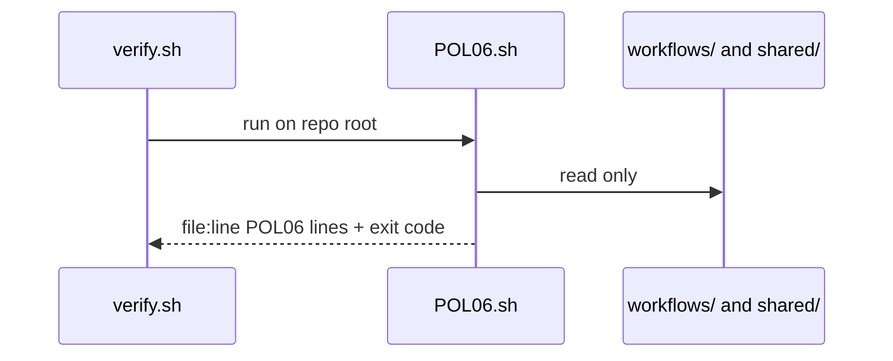
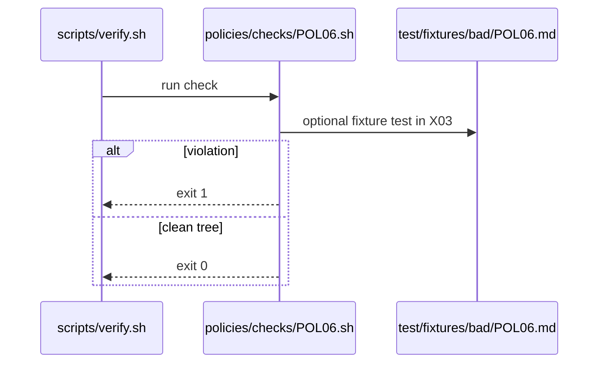

# POL06: Network allowlist, no wildcard
- Status: todo
- Area: policies
- Wave: W1
- Block: 1
- Lane: Cursor CLI
- Depends on: C01, S01
- proof: bash policies/checks/POL06.sh test/fixtures/bad/POL06.md (must exit 1); bash policies/checks/POL06.sh test/fixtures/good/POL06.md (exit 0); ./scripts/verify.sh includes POL06
- door: two-way
## Goal
Encode network allowlist, no wildcard as policy-as-code: `policies/POL06.yml`, gate script `policies/checks/POL06.sh`, and bad fixture `test/fixtures/bad/POL06.md`, enforced by C01.
## Context
Outbound network must use explicit host allowlists. Wildcard `*` is forbidden unless gh-aw docs require a documented exception (none in v1 catalog). Personal account catalog; org-ready rulesets in G05 may mirror these checks later.

Policy text: `network.allowed` lists named hosts only; empty means closed default from shared security.

`policies/checks/POL06.sh` behaviour: Fail on `*` in network allowed lists across workflows and shared security fragments.

Bad fixture `test/fixtures/bad/POL06.md`: shared security with `allowed: ['*']`.
## Steps
1. Write `policies/POL06.yml` with machine-readable rules.
2. Implement `policies/checks/POL06.sh` (bash, exit codes, clear stderr).
3. Add `test/fixtures/bad/POL06.md` triggering a single failure.
4. Add matching good coverage in `test/fixtures/good/` where needed.
5. Register check in `scripts/verify.sh`.
## Definition of Done
- [ ] Policy YAML, check script, and bad fixture exist for POL06
- [ ] `policies/checks/POL06.sh` fails on bad fixture and passes on good catalog
- [ ] Policy text included in this PBI and in `shared/policies/` or `policies/` doc
- [ ] Gate log on SHA shows POL06 executed
## Technical design
- Components and files: `policies/POL06.yml` (rule + why), `policies/checks/POL06.sh`, `test/fixtures/bad/POL06.md` (shared POL design, see [00-overview.md](00-overview.md#shared-technical-design-pol01-pol23))
- Interfaces: Check gets the repo root, prints `file:line POL06 message`, exit 1 on hit; verify.sh loops all checks. This check: `network.allowed` list, no `*`
- Sequence:

- Failure modes: Tautological check that never fails, so POL23 runs it on its bad fixture `test/fixtures/bad/POL06.md` (`*`) and needs exit 1
- Security: Read-only grep or yq, no tokens, no network
- Observability: One line per hit `file:line POL06 message` in verify.sh output
- Cost: 0 AIC (script)
- Rollback: Remove POL06.sh from the verify.sh loop (the policy doc stays)
- Proof: verify.sh fails on `test/fixtures/bad/POL06.md` and passes on `test/fixtures/good/`
- Door: two-way (script)
## Evidence
(commands, logs, verify log on SHA, run links)
## Flow

## Named asks for Sven
none
## Cost
n/a
## Sources
- https://github.github.com/gh-aw/guides/sharing-workflows/
- https://github.github.com/gh-aw/reference/auth/
- https://github.github.com/gh-aw/reference/cost-management/
- https://github.github.com/gh-aw/reference/imports/
- https://github.github.com/gh-aw/reference/engines/copilot/
- https://github.github.com/svennijhuis/agentic-workflows
