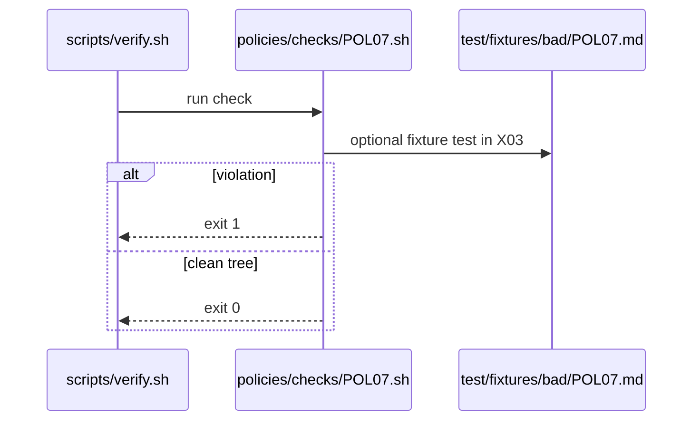

# POL07: Tool, MCP, and bash allowlists
- Status: todo
- Area: policies
- Wave: W1
- Block: 1
- Lane: Cursor CLI
- Depends on: C01, S04
- proof: bash policies/checks/POL07.sh test/fixtures/bad/POL07.md (must exit 1); bash policies/checks/POL07.sh test/fixtures/good/POL07.md (exit 0); ./scripts/verify.sh includes POL07
- door: two-way
## Goal
Encode tool, mcp, and bash allowlists as policy-as-code: `policies/POL07.yml`, gate script `policies/checks/POL07.sh`, and bad fixture `test/fixtures/bad/POL07.md`, enforced by C01.
## Context
Agents must declare explicit tool, MCP server, and bash command allowlists. Default-deny posture. Personal account catalog; org-ready rulesets in G05 may mirror these checks later.

Policy text: Wildcard tool enablement is forbidden. MCP servers must be named and scoped.

`policies/checks/POL07.sh` behaviour: Validate `tools`, `mcp`, and bash sections against policy schema in `policies/POL07.yml`.

Bad fixture `test/fixtures/bad/POL07.md`: Workflow enabling all tools or unrestricted bash.
## Steps
1. Write `policies/POL07.yml` with machine-readable rules.
2. Implement `policies/checks/POL07.sh` (bash, exit codes, clear stderr).
3. Add `test/fixtures/bad/POL07.md` triggering a single failure.
4. Add matching good coverage in `test/fixtures/good/` where needed.
5. Register check in `scripts/verify.sh`.
## Definition of Done
- [ ] Policy YAML, check script, and bad fixture exist for POL07
- [ ] `policies/checks/POL07.sh` fails on bad fixture and passes on good catalog
- [ ] Policy text included in this PBI and in `shared/policies/` or `policies/` doc
- [ ] Gate log on SHA shows POL07 executed
## Evidence
(commands, logs, verify log on SHA, run links)
## Flow

## Named asks for Sven
none
## Cost
n/a
## Sources
- https://github.github.com/gh-aw/guides/sharing-workflows/
- https://github.github.com/gh-aw/reference/auth/
- https://github.github.com/gh-aw/reference/cost-management/
- https://github.github.com/gh-aw/reference/imports/
- https://github.github.com/gh-aw/reference/engines/copilot/
- https://github.github.com/svennijhuis/agentic-workflows
