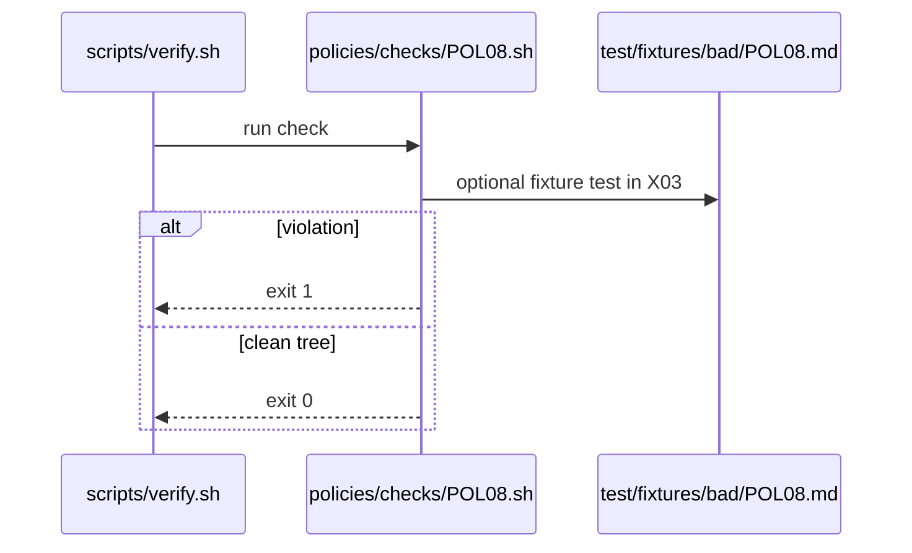

# POL08: safe-output max on every output
- Status: todo
- Area: policies
- Wave: W1
- Block: 1
- Lane: Cursor CLI
- Depends on: C01, O01
- proof: bash policies/checks/POL08.sh test/fixtures/bad/POL08.md (must exit 1); bash policies/checks/POL08.sh test/fixtures/good/POL08.md (exit 0); ./scripts/verify.sh includes POL08
- door: two-way
## Goal
Encode safe-output max on every output as policy-as-code: `policies/POL08.yml`, gate script `policies/checks/POL08.sh`, and bad fixture `test/fixtures/bad/POL08.md`, enforced by C01.
## Context
Each safe-output definition must include a `max` limit (issues, PRs, comments) appropriate to the workflow. Personal account catalog; org-ready rulesets in G05 may mirror these checks later.

Policy text: Unbounded safe-outputs are not allowed.

`policies/checks/POL08.sh` behaviour: Parse safe-outputs blocks; fail when any output type lacks `max` or exceeds policy ceiling.

Bad fixture `test/fixtures/bad/POL08.md`: create-pull-request without max.
## Steps
1. Write `policies/POL08.yml` with machine-readable rules.
2. Implement `policies/checks/POL08.sh` (bash, exit codes, clear stderr).
3. Add `test/fixtures/bad/POL08.md` triggering a single failure.
4. Add matching good coverage in `test/fixtures/good/` where needed.
5. Register check in `scripts/verify.sh`.
## Definition of Done
- [ ] Policy YAML, check script, and bad fixture exist for POL08
- [ ] `policies/checks/POL08.sh` fails on bad fixture and passes on good catalog
- [ ] Policy text included in this PBI and in `shared/policies/` or `policies/` doc
- [ ] Gate log on SHA shows POL08 executed
## Evidence
(commands, logs, verify log on SHA, run links)
## Flow

## Named asks for Sven
none
## Cost
n/a
## Sources
- https://github.github.com/gh-aw/guides/sharing-workflows/
- https://github.github.com/gh-aw/reference/auth/
- https://github.github.com/gh-aw/reference/cost-management/
- https://github.github.com/gh-aw/reference/imports/
- https://github.github.com/gh-aw/reference/engines/copilot/
- https://github.github.com/svennijhuis/agentic-workflows
