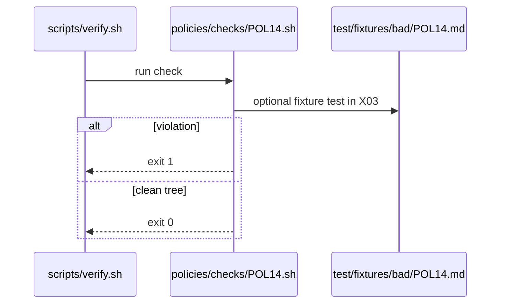

# POL14: No merge-pull-request, no unsafe pull_request_target
- Status: todo
- Area: policies
- Wave: W1
- Block: 1
- Lane: Cursor CLI
- Depends on: C01
- proof: bash policies/checks/POL14.sh test/fixtures/bad/POL14.md (must exit 1); bash policies/checks/POL14.sh test/fixtures/good/POL14.md (exit 0); ./scripts/verify.sh includes POL14
- door: two-way
## Goal
Encode no merge-pull-request, no unsafe pull_request_target as policy-as-code: `policies/POL14.yml`, gate script `policies/checks/POL14.sh`, and bad fixture `test/fixtures/bad/POL14.md`, enforced by C01.
## Context
Workflows must not auto-merge PRs or use unsafe `pull_request_target` patterns that expand attack surface. Personal account catalog; org-ready rulesets in G05 may mirror these checks later.

Policy text: Ban `merge-pull-request` safe-output and `pull_request_target` triggers in catalog.

`policies/checks/POL14.sh` behaviour: Grep compiled and source workflows for forbidden patterns; exit 1 on match.

Bad fixture `test/fixtures/bad/POL14.md`: Safe-output merge-pull-request example.
## Steps
1. Write `policies/POL14.yml` with machine-readable rules.
2. Implement `policies/checks/POL14.sh` (bash, exit codes, clear stderr).
3. Add `test/fixtures/bad/POL14.md` triggering a single failure.
4. Add matching good coverage in `test/fixtures/good/` where needed.
5. Register check in `scripts/verify.sh`.
## Definition of Done
- [ ] Policy YAML, check script, and bad fixture exist for POL14
- [ ] `policies/checks/POL14.sh` fails on bad fixture and passes on good catalog
- [ ] Policy text included in this PBI and in `shared/policies/` or `policies/` doc
- [ ] Gate log on SHA shows POL14 executed
## Evidence
(commands, logs, verify log on SHA, run links)
## Flow

## Named asks for Sven
none
## Cost
n/a
## Sources
- https://github.github.com/gh-aw/guides/sharing-workflows/
- https://github.github.com/gh-aw/reference/auth/
- https://github.github.com/gh-aw/reference/cost-management/
- https://github.github.com/gh-aw/reference/imports/
- https://github.github.com/gh-aw/reference/engines/copilot/
- https://github.github.com/svennijhuis/agentic-workflows
