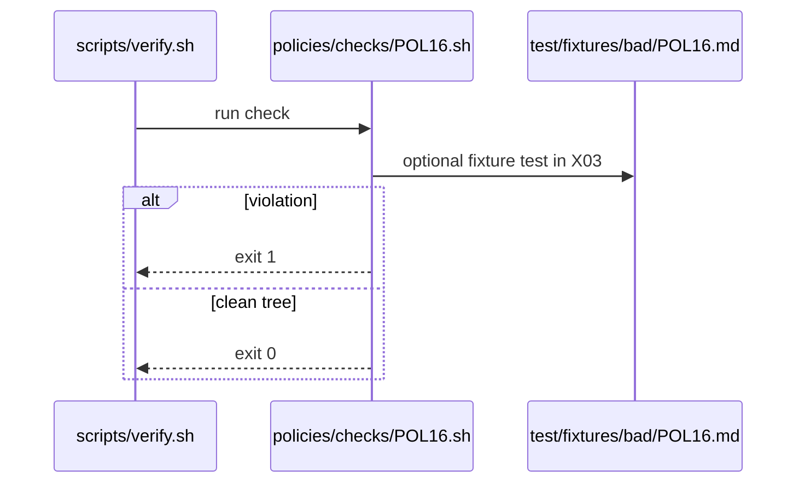

# POL16: House style (no em dash, fixed report format)
- Status: todo
- Area: policies
- Wave: W1
- Block: 1
- Lane: Cursor CLI
- Depends on: C01, C11
- proof: bash policies/checks/POL16.sh test/fixtures/bad/POL16.md (must exit 1); bash policies/checks/POL16.sh test/fixtures/good/POL16.md (exit 0); ./scripts/verify.sh includes POL16
- door: two-way
## Goal
Encode house style (no em dash, fixed report format) as policy-as-code: `policies/POL16.yml`, gate script `policies/checks/POL16.sh`, and bad fixture `test/fixtures/bad/POL16.md`, enforced by C01.
## Context
Markdown and reports must not contain U+2013 or U+2014; issue and PR bodies follow `shared/reporting.md` format. Personal account catalog; org-ready rulesets in G05 may mirror these checks later.

Policy text: Use ASCII hyphen or rephrase; reports use fixed headings and footers from shared reporting.

`policies/checks/POL16.sh` behaviour: Unicode dash scan on tracked md files; optional structure check against reporting template for workflow outputs.

Bad fixture `test/fixtures/bad/POL16.md`: Text containing an en dash or em dash character.
## Steps
1. Write `policies/POL16.yml` with machine-readable rules.
2. Implement `policies/checks/POL16.sh` (bash, exit codes, clear stderr).
3. Add `test/fixtures/bad/POL16.md` triggering a single failure.
4. Add matching good coverage in `test/fixtures/good/` where needed.
5. Register check in `scripts/verify.sh`.
## Definition of Done
- [ ] Policy YAML, check script, and bad fixture exist for POL16
- [ ] `policies/checks/POL16.sh` fails on bad fixture and passes on good catalog
- [ ] Policy text included in this PBI and in `shared/policies/` or `policies/` doc
- [ ] Gate log on SHA shows POL16 executed
## Evidence
(commands, logs, verify log on SHA, run links)
## Flow

## Named asks for Sven
none
## Cost
n/a
## Sources
- https://github.github.com/gh-aw/guides/sharing-workflows/
- https://github.github.com/gh-aw/reference/auth/
- https://github.github.com/gh-aw/reference/cost-management/
- https://github.github.com/gh-aw/reference/imports/
- https://github.github.com/gh-aw/reference/engines/copilot/
- https://github.github.com/svennijhuis/agentic-workflows
