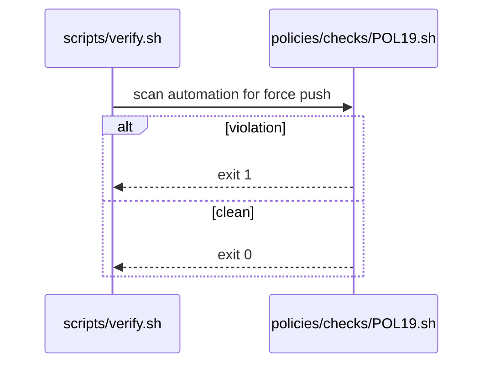

# POL19: No force push
- Status: todo
- Area: policies
- Wave: W1
- Block: 1
- Lane: Builder
- Depends on: C01
- proof: bash policies/checks/POL19.sh test/fixtures/bad/POL19.md (must exit 1); bash policies/checks/POL19.sh test/fixtures/good/POL19.md (exit 0); ./scripts/verify.sh includes POL19
- door: one-way
- one-way gate: Sven's exact yes required (named ask in its block). Rollback: remove ruleset change and revert automation commit
## Goal
Forbid force push, `+refs` push specs, and `--force-with-lease` in repo automation, release scripts, and documented operator procedures. Enforce via ruleset (org-ready, G05) and `policies/checks/POL19.sh`.
## Context
agentPacks generated marketplace commits must not be rewritten by force push (see agentPacks plan PBI 02). Tag moves for moving `v1` are a separate Sven decision (Q7), not a blanket force push to main.
## Steps
1. Write `policies/POL19.yml` policy text.
2. Implement `policies/checks/POL19.sh`: scan `.github/workflows/`, `scripts/`, and release docs for `--force`, `+refs`, `--force-with-lease`, and `git push --force` patterns.
3. Add `test/fixtures/bad/POL19.md` with a sample workflow step that force-pushes tags.
4. Register in `scripts/verify.sh`.
5. Document org ruleset mirror in G05.
## Definition of Done
- [ ] Policy YAML, check script, and bad fixture exist for POL19
- [ ] Check fails on bad fixture and passes on clean tree
- [ ] Policy text included in this PBI
- [ ] Verify log on SHA shows POL19 executed
## Evidence
(commands, verify log on SHA)
## Flow

## Named asks for Sven
Q7 (moving `v1` tag exception policy, if any)
## Cost
n/a
## Sources
- Plan v3.1 POL19
- agentPacks cloud-local plan PBI 02 (no force push on generated commit)
