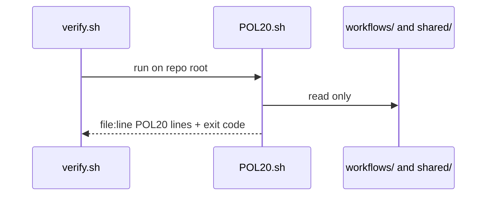
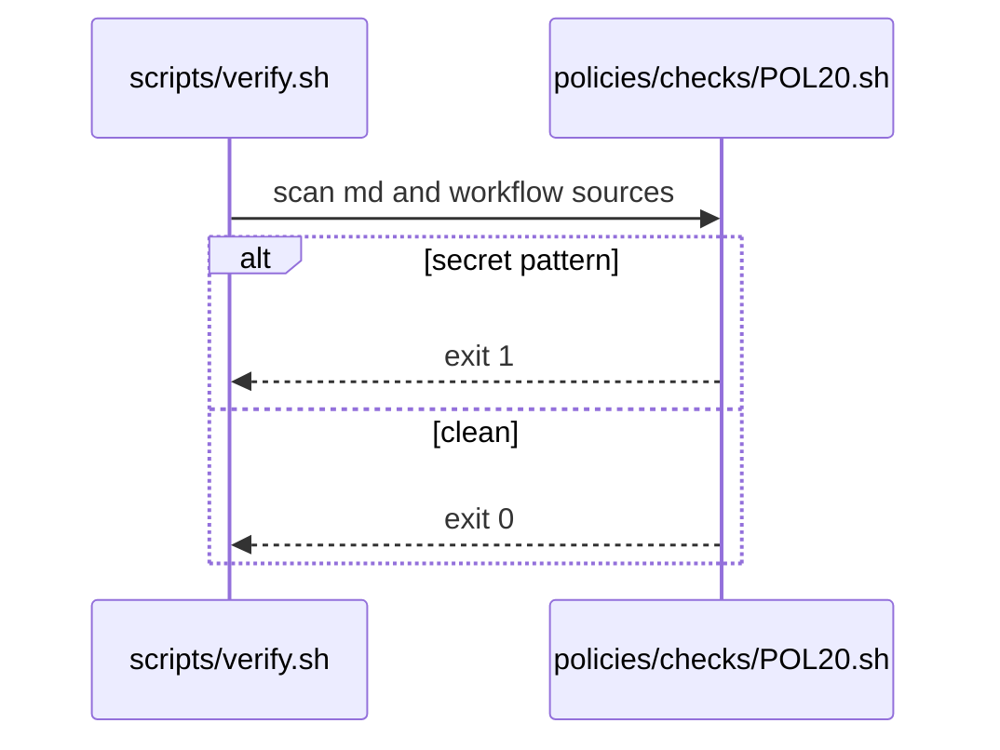

# POL20: No tokens in markdown
- Status: todo
- Area: policies
- Wave: W1
- Block: 1
- Lane: Builder
- Depends on: C01, POL04
- proof: bash policies/checks/POL20.sh test/fixtures/bad/POL20.md (must exit 1); bash policies/checks/POL20.sh test/fixtures/good/POL20.md (exit 0); ./scripts/verify.sh includes POL20
- door: two-way
## Goal
Secret-pattern scan on markdown and workflow sources so tokens, PATs, and private keys never land in git. Complements gitleaks (POL04) with markdown-focused patterns in `policies/checks/POL20.sh`.
## Context
Named asks (Q3, Y06, B04, M02) use masked fields only, never files. Bad fixture demonstrates a fake PAT-shaped string in a doc snippet.
## Steps
1. Write `policies/POL20.yml` with allowed placeholders (example: `***`, `REDACTED`, env var names without values).
2. Implement `policies/checks/POL20.sh` with conservative regex set (GitHub PAT prefixes, AWS keys, JWT segments, `Bearer` plus long hex).
3. Add `test/fixtures/bad/POL20.md` triggering one failure.
4. Register in `scripts/verify.sh`.
## Definition of Done
- [ ] Policy YAML, check script, and bad fixture exist for POL20
- [ ] Check fails on bad fixture and passes on good catalog
- [ ] Policy text included in this PBI
- [ ] Verify log on SHA shows POL20 executed
## Technical design
- Components and files: `policies/POL20.yml` (rule + why), `policies/checks/POL20.sh`, `test/fixtures/bad/POL20.md` (shared POL design, see [00-overview.md](00-overview.md#shared-technical-design-pol01-pol23))
- Interfaces: Check gets the repo root, prints `file:line POL20 message`, exit 1 on hit; verify.sh loops all checks. This check: secret-pattern scan on `**/*.md`
- Sequence:

- Failure modes: Tautological check that never fails, so POL23 runs it on its bad fixture `test/fixtures/bad/POL20.md` (token in doc) and needs exit 1
- Security: Read-only grep or yq, no tokens, no network
- Observability: One line per hit `file:line POL20 message` in verify.sh output
- Cost: 0 AIC (script)
- Rollback: Remove POL20.sh from the verify.sh loop (the policy doc stays)
- Proof: verify.sh fails on `test/fixtures/bad/POL20.md` and passes on `test/fixtures/good/`
- Door: two-way (script)
## Evidence
(commands, verify log on SHA)
## Flow

## Named asks for Sven
none
## Cost
n/a
## Sources
- Plan v3.1 POL20
- Plan v3.2 POL20 secret pattern scan
