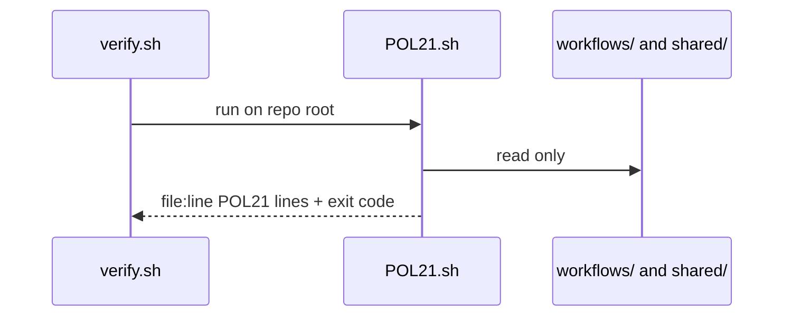
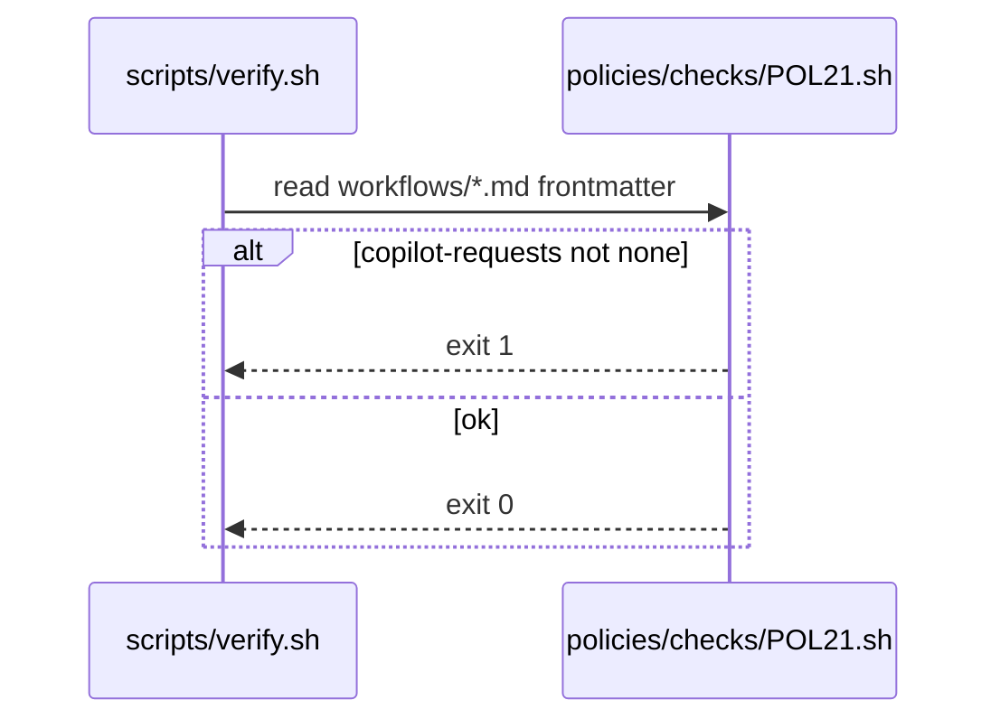

# POL21: `copilot-requests: none` required
- Status: todo
- Area: policies
- Wave: W1
- Block: 1
- Lane: Builder
- Depends on: C01, C04
- proof: bash policies/checks/POL21.sh test/fixtures/bad/POL21.md (must exit 1); bash policies/checks/POL21.sh test/fixtures/good/POL21.md (exit 0); ./scripts/verify.sh includes POL21
- door: two-way
## Goal
Every catalog workflow frontmatter sets `copilot-requests: none` for personal account billing. Org central billing path is documented in G05, not enabled here.
## Context
Plan v3.2 and settled decisions: `copilot-requests` write permission is org billing only. PR #2 evidence used personal `COPILOT_GITHUB_TOKEN` without `copilot-requests`.
## Steps
1. Write `policies/POL21.yml`.
2. Implement `policies/checks/POL21.sh`: assert `copilot-requests: none` (or equivalent deny) in each `workflows/*.md` frontmatter.
3. Add `test/fixtures/bad/POL21.md` with `copilot-requests: write`.
4. Register in `scripts/verify.sh`.
## Definition of Done
- [ ] Policy YAML, check script, and bad fixture exist for POL21
- [ ] Check fails on bad fixture and passes on catalog
- [ ] Policy text included in this PBI
- [ ] Verify log on SHA shows POL21 executed
## Technical design
- Components and files: `policies/POL21.yml` (rule + why), `policies/checks/POL21.sh`, `test/fixtures/bad/POL21.md` (shared POL design, see [00-overview.md](00-overview.md#shared-technical-design-pol01-pol23))
- Interfaces: Check gets the repo root, prints `file:line POL21 message`, exit 1 on hit; verify.sh loops all checks. This check: `copilot-requests: none`
- Sequence:

- Failure modes: Tautological check that never fails, so POL23 runs it on its bad fixture `test/fixtures/bad/POL21.md` (key missing) and needs exit 1
- Security: Read-only grep or yq, no tokens, no network
- Observability: One line per hit `file:line POL21 message` in verify.sh output
- Cost: 0 AIC (script)
- Rollback: Remove POL21.sh from the verify.sh loop (the policy doc stays)
- Proof: verify.sh fails on `test/fixtures/bad/POL21.md` and passes on `test/fixtures/good/`
- Door: two-way (script)
## Evidence
(commands, verify log on SHA)
## Flow

## Named asks for Sven
Q4 (budget and Copilot plan, informational)
## Cost
n/a
## Sources
- https://github.github.com/gh-aw/reference/engines/copilot/
- Plan v3.2 POL21
- Settled decisions `docs/pbi/decisions/0002-settled-decisions.md`
