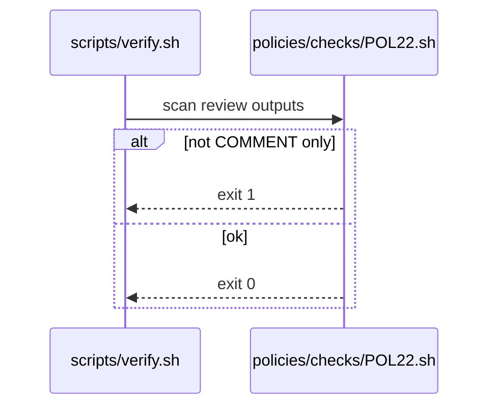

# POL22: PR review output COMMENT only
- Status: todo
- Area: policies
- Wave: W1
- Block: 1
- Lane: Builder
- Depends on: C01, O01
- proof: bash policies/checks/POL22.sh test/fixtures/bad/POL22.md (must exit 1); bash policies/checks/POL22.sh test/fixtures/good/POL22.md (exit 0); ./scripts/verify.sh includes POL22
- door: two-way
## Goal
`submit-pull-request-review` safe output allows only `COMMENT` event (report-only). No APPROVE or REQUEST_CHANGES from catalog review workflows (F01, F13, etc.).
## Context
Plan v3.2 and F01 v3.5: manual pr-review stays read-only on PR state. Pairs with POL03 staged/report-only before writes.
## Steps
1. Write `policies/POL22.yml`.
2. Implement `policies/checks/POL22.sh`: scan workflows for `submit-pull-request-review` blocks; fail if event is not COMMENT or if REQUEST_CHANGES appears.
3. Add `test/fixtures/bad/POL22.md` with REQUEST_CHANGES.
4. Register in `scripts/verify.sh`.
## Definition of Done
- [ ] Policy YAML, check script, and bad fixture exist for POL22
- [ ] Check fails on bad fixture and passes on F01-shaped good workflow
- [ ] Policy text included in this PBI
- [ ] Verify log on SHA shows POL22 executed
## Evidence
(commands, verify log on SHA)
## Flow

## Named asks for Sven
none
## Cost
n/a
## Sources
- Plan v3.2 POL22
- F01 pr-review PBI
