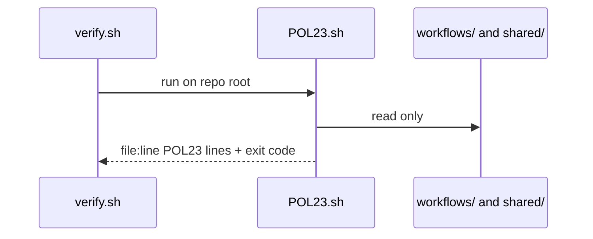
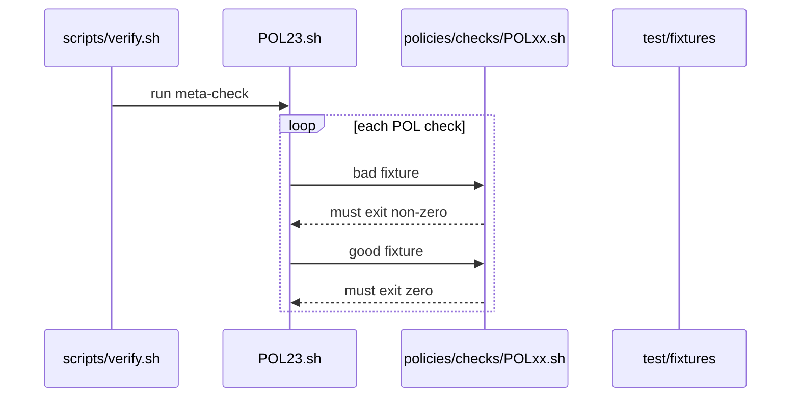

# POL23: No tautological policy checks
- Status: todo
- Area: policies
- Wave: W1
- Block: 1
- Lane: Builder
- Depends on: C01, X03
- proof: bash policies/checks/POL23.sh test/fixtures/bad/POL23.md (must exit 1); bash policies/checks/POL23.sh test/fixtures/good/gate-minimal.md (exit 0); ./scripts/verify.sh runs POL23 on every policies/checks/POL*.sh
- door: two-way
## Goal
Every policy gate check must be falsifiable: a bad fixture must fail and a good fixture must pass. `scripts/verify.sh` runs each `policies/checks/POL*.sh` against both `test/fixtures/bad/` and `test/fixtures/good/` and fails if the bad fixture passes or the good fixture fails.
## Context
Gist review point 26 (kill tautological tests). [X03](../testing/X03-gate-fixtures.md) documents fixture layout; POL23 meta-checks that other checks are not no-ops. Example bad case: a check script that always exits 0 even on intentional violations (represented by `test/fixtures/bad/POL23.md` referencing a stub check).
## Steps
1. Write `policies/POL23.yml` policy text (meta-policy for check quality).
2. Implement `policies/checks/POL23.sh`: for each `policies/checks/POL*.sh` except POL23 itself, run against paired good/bad fixtures when present; fail on wrong exit codes.
3. Add `test/fixtures/bad/POL23.md` describing a check that always exits 0 (tautological).
4. Wire POL23 into `scripts/verify.sh` after per-policy checks are registered.
5. Update [X03](../testing/X03-gate-fixtures.md) to require good and bad coverage per POL and link POL23.
## Definition of Done
- [ ] Policy YAML, `policies/checks/POL23.sh`, and bad fixture exist
- [ ] POL23 fails when a check passes on its bad fixture or fails on its good fixture
- [ ] `scripts/verify.sh` invokes POL23 on green SHA after POL01 through POL22 checks exist
- [ ] X03 documents good and bad paths and references POL23
- [ ] Mermaid flow present
## Technical design
- Components and files: `policies/POL23.yml` (rule + why), `policies/checks/POL23.sh`, `test/fixtures/bad/POL23.md` (shared POL design, see [00-overview.md](00-overview.md#shared-technical-design-pol01-pol23))
- Interfaces: Check gets the repo root, prints `file:line POL23 message`, exit 1 on hit; verify.sh loops all checks. This check: every POL check exits 1 on its bad fixture
- Sequence:

- Failure modes: Tautological check that never fails, so POL23 runs it on its bad fixture `test/fixtures/bad/POL23.md` (check that always passes) and needs exit 1
- Security: Read-only grep or yq, no tokens, no network
- Observability: One line per hit `file:line POL23 message` in verify.sh output
- Cost: 0 AIC (script)
- Rollback: Remove POL23.sh from the verify.sh loop (the policy doc stays)
- Proof: verify.sh fails on `test/fixtures/bad/POL23.md` and passes on `test/fixtures/good/`
- Door: two-way (script)
## Evidence
(verify log on SHA showing POL23 fail on tautological stub, then pass after fix)
## Flow

## Named asks for Sven
(none)
## Cost
n/a
## Sources
- Gist review point 26 (tautological tests)
- [gist-review.md](../gist-review.md) A4
- Plan v3.6 POL23
