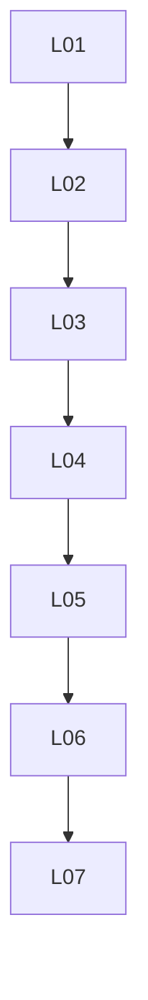

# release: overview

**Purpose:** Tags, bump-pin, deprecation, upstream watch.

## PBIs

- [L01: L01-v1-moving-v1-changelog](L01-v1-moving-v1-changelog.md)
- [L02: L02-update-vs-upgrade-safe-update](L02-update-vs-upgrade-safe-update.md)
- [L03: L03-deprecation](L03-deprecation.md)
- [L04: L04-gh-aw-tool-pin](L04-gh-aw-tool-pin.md)
- [L05: L05-workflow-updater](L05-workflow-updater.md)
- [L06: L06-changeset-generator](L06-changeset-generator.md)
- [L07: L07-upstream-watch](L07-upstream-watch.md)

## Dependency sketch

